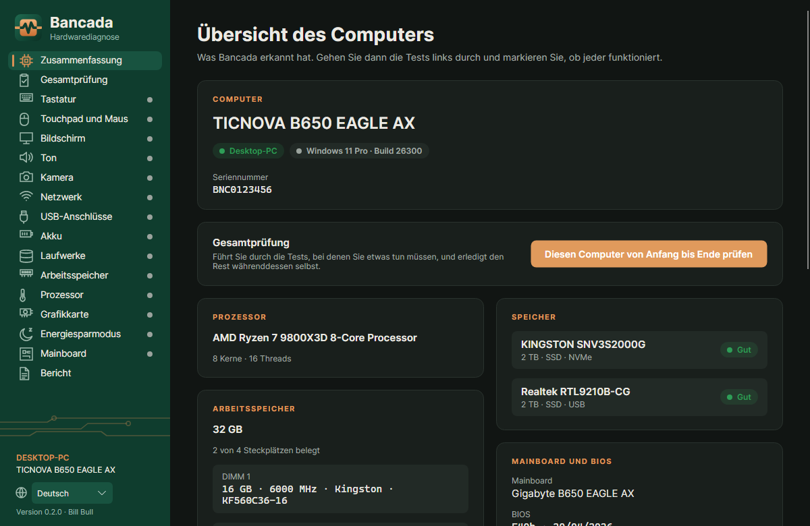
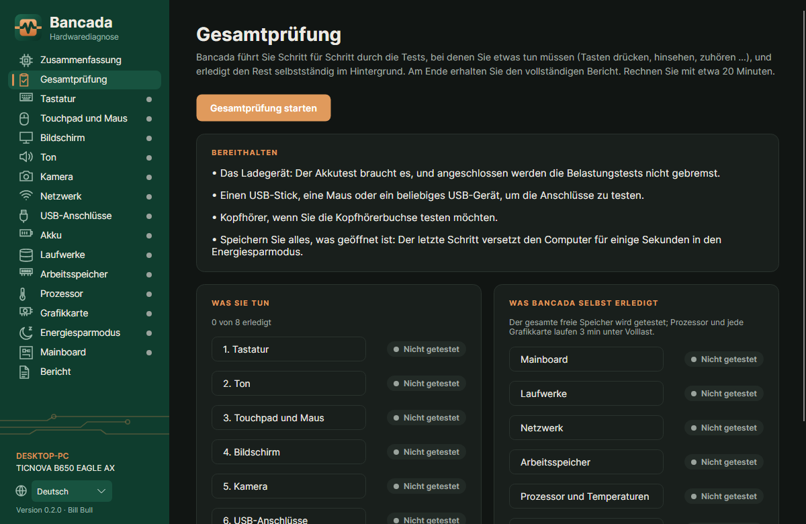
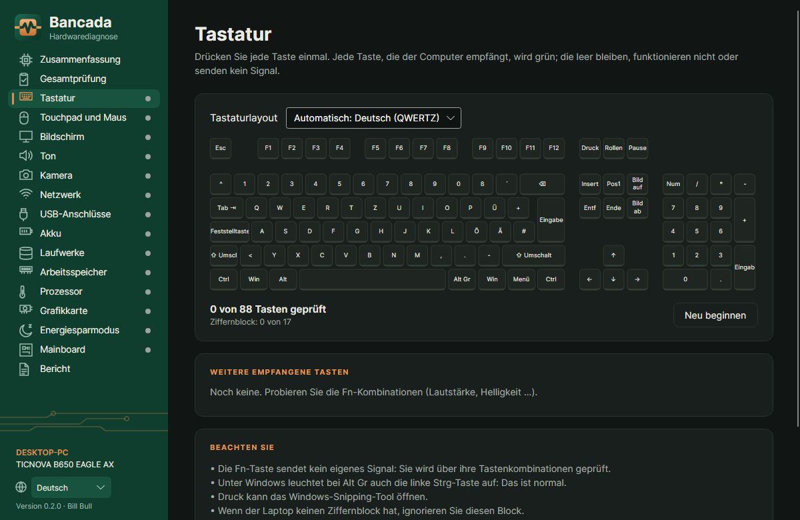
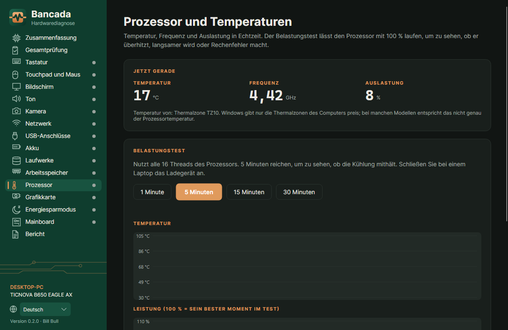
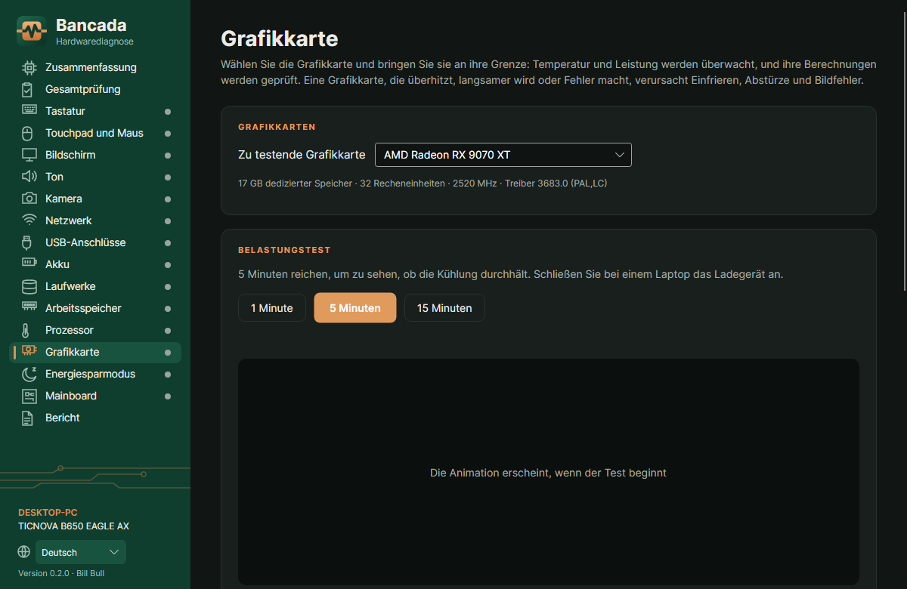
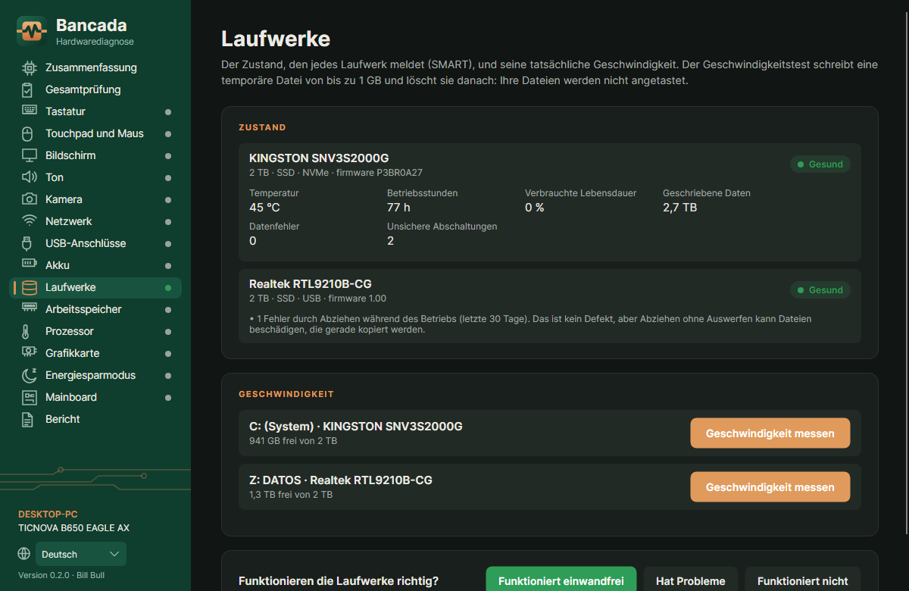
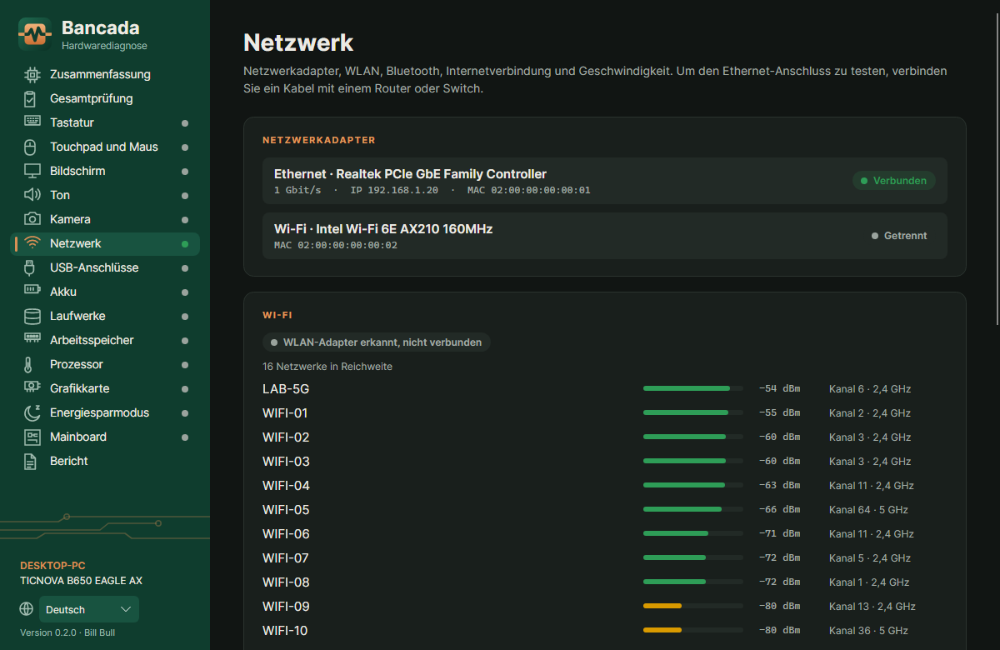

  

<h1 align="center">Bancada</h1>

  <b>Hardwarediagnose für Techniker und Enthusiasten.</b> 
  Laptops und Desktop-PCs · Windows und Linux · nativ, frei und kostenlos

  
  
  

  <a href="README.md">English</a> · <a href="README.es.md">Español</a> · <a href="README.pt.md">Português</a> · <a href="README.fr.md">Français</a> · <b>Deutsch</b> · <a href="README.it.md">Italiano</a>

  <a href="https://bancada-hw.github.io/bancada/de/"><b>Website</b></a> ·
  <a href="docs/guia/de.md"><b>Anleitung</b></a> ·
  <a href="https://github.com/bancada-hw/bancada/releases/latest"><b>Herunterladen</b></a> ·
  <a href="docs/desarrollo/de.md">Kompilieren und übersetzen</a>

---

Bancada (spanisch für *Werkbank*) ist eine Werkbank in einer einzigen Datei: Sie öffnen sie auf dem
Computer, den Sie prüfen, sehen, was drinsteckt, und testen jedes Teil – von der Tastatur bis zur
Grafikkarte. Am Ende erhalten Sie einen **PDF-Bericht**, den Sie dem Kunden übergeben oder archivieren können.

- **Wirklich nativ.** Keine Web-App, kein Electron. Eine einzige ausführbare Datei mit etwa 60 MB, ohne Installation.
- **Kein Konto, keine Werbung, keine Telemetrie.** Es werden keine Daten gesendet.
- **Für die Werkstatt gemacht.** Eine geführte Gesamtprüfung in etwa 20 Minuten, mit einem Urteil pro Test.

  

## Herunterladen

| System | Datei | So öffnen Sie sie |
|---|---|---|
| **Windows 10/11** (64 Bit) | [Bancada-windows-x64.exe](https://github.com/bancada-hw/bancada/releases/latest/download/Bancada-windows-x64.exe) | Doppelklick. Erscheint „Der Computer wurde durch Windows geschützt“, klicken Sie auf *Weitere Informationen › Trotzdem ausführen* (die Datei ist noch nicht signiert). |
| **Linux** (64 Bit) | [Bancada-linux-x64](https://github.com/bancada-hw/bancada/releases/latest/download/Bancada-linux-x64) | `chmod +x Bancada-linux-x64 && ./Bancada-linux-x64` |

Fast alles funktioniert ohne Administratorrechte. Mit ihnen (oder `sudo` unter Linux) sehen Sie zusätzlich
die RAM-Module, die Seriennummer und die vollständigen SMART-Daten von SATA-Laufwerken.

## Was es prüft

| | Test | Was er macht |
|---|---|---|
| 🧾 | **Übersicht** | Hersteller, Modell und Seriennummer, Gerätetyp, Prozessor, RAM pro Steckplatz, Grafikkarten, Laufwerke, Akku, Mainboard und BIOS. |
| 🧭 | **Gesamtprüfung** | Führt Sie durch die Tests zum Mitmachen und erledigt die automatischen im Hintergrund. |
| ⌨️ | **Tastatur** | Tastatur in ihrer echten Form (ISO, ANSI, ABNT2): Jede empfangene Taste leuchtet auf. 9 Layouts. |
| 🖱️ | **Touchpad und Maus** | Fläche, die sich beim Überfahren füllt, Tasten, Gesten, Scrollen, Seitentasten, Touchscreen und Stift. |
| 🖥️ | **Bildschirm** | Vollfarben, Verläufe und Raster im Vollbild für tote Pixel, Flecken und Lichthöfe. |
| 🔊 | **Ton** | Linker und rechter Lautsprecher, Sweep von tief nach hoch, Mikrofonpegel und Aufnehmen-Abspielen. |
| 📷 | **Kamera** | Live-Bild jeder Kamera; warnt, wenn es schwarz ist (Abdeckung). Nichts wird gespeichert. |
| 🌐 | **Netzwerk** | Adapter, WLAN und Netzwerke in der Nähe, Bluetooth, schrittweise Verbindungsprüfung und Internetgeschwindigkeit. |
| 🔌 | **USB-Anschlüsse** | Markiert jeden Anschluss, der reagiert, mit seiner echten Geschwindigkeit; erkennt USB 3 mit USB-2-Tempo. |
| 🔋 | **Akku und Ladegerät** | Zustand und Zyklen, Leistungsaufnahme live, Entladetest mit echter Laufzeit und Ladegerättest. |
| 💽 | **Laufwerke** | SMART-Zustand, vom System protokollierte Fehler und echte Lese- und Schreibgeschwindigkeit. |
| 🧠 | **Arbeitsspeicher** | 8 Muster über den gesamten freien Speicher, jedes Bit wird geprüft. |
| 🌡️ | **Prozessor** | Temperaturen, Frequenz und Belastungstest, der Überhitzung, Drosselung und Rechenfehler erkennt. |
| 🎮 | **Grafikkarte** | Belastung jeder Grafikkarte (dediziert oder integriert) mit geprüften Berechnungen und Grafikspeichertest. |
| 🌙 | **Energiesparmodus** | Schickt den Computer schlafen, weckt ihn und prüft, ob Netzwerk und Geräte zurückkommen. |
| 🧩 | **Mainboard** | Firmware, TPM, fehlerhafte Geräte, PCI-Express-Verbindungen, Hardwarefehler und CMOS-Batterie. |
| 📄 | **Bericht** | Alles zusammen als A4-PDF mit Messwerten, Notizen und Urteilen. |

Jeder Test endet mit einem Urteil: **Funktioniert einwandfrei**, **Hat Probleme** oder **Funktioniert nicht**.
Automatische Tests schlagen es vor, Sie entscheiden. Die [Anleitung](docs/guia/de.md) erklärt jeden Test
Schritt für Schritt.

<table>
  <tr>
    <td></td>
    <td></td>
  </tr>
  <tr>
    <td></td>
    <td></td>
  </tr>
  <tr>
    <td></td>
    <td></td>
  </tr>
</table>

## Sprachen

Spanisch, Englisch, brasilianisches Portugiesisch, Französisch, Deutsch und Italienisch. Bancada folgt der
Systemsprache, die sich in der Seitenleiste ändern lässt. Der Bericht erscheint in der gewählten Sprache.
Möchten Sie Ihre hinzufügen? Siehe [Übersetzen](docs/desarrollo/de.md#bancada-übersetzen): Programmieren
ist nicht nötig.

## Das Projekt unterstützen

Bancada ist kostenlos und bleibt es. Wenn es Ihnen in der Werkstatt Zeit spart, können Sie es mit einer
[Spende](https://github.com/sponsors/bancada-hw) unterstützen, Fehler unter
[Issues](https://github.com/bancada-hw/bancada/issues) melden oder es in Ihre Sprache übersetzen.

## Lizenz

Copyright © 2026 Bill Bull. Freie Software unter der [GPL-3.0 oder später](LICENSE), mit den zusätzlichen
Bedingungen in [AVISO.md](AVISO.md): Verbreitete Versionen müssen das Originalprojekt nennen, angeben, ob sie
verändert sind, und dürfen weder den Namen noch das Logo von Bancada verwenden.

Erstellt mit [.NET](https://dotnet.microsoft.com), [Avalonia UI](https://avaloniaui.net),
[SkiaSharp](https://github.com/mono/SkiaSharp) und der Schrift [Inter](https://rsms.me/inter/).
