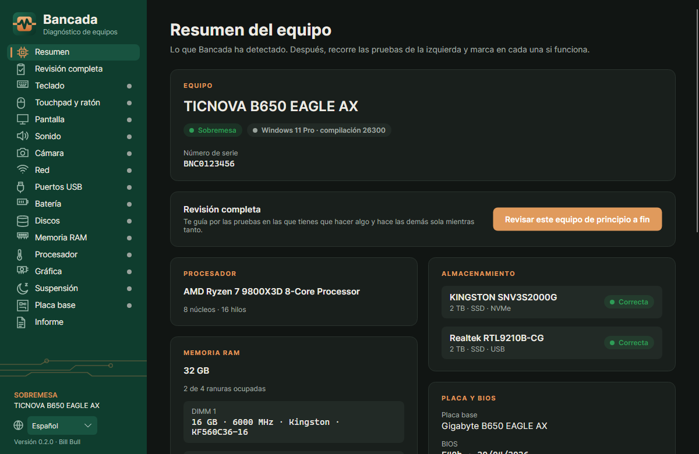
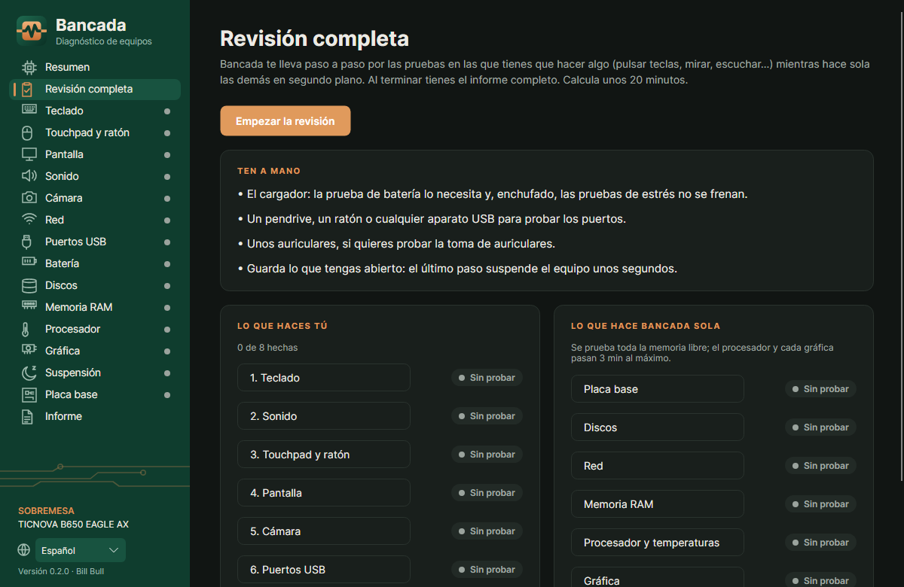
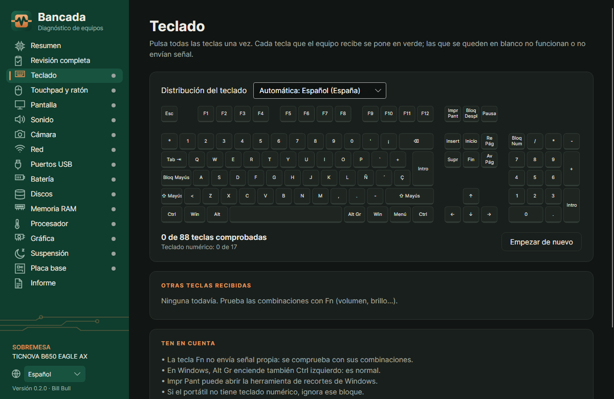
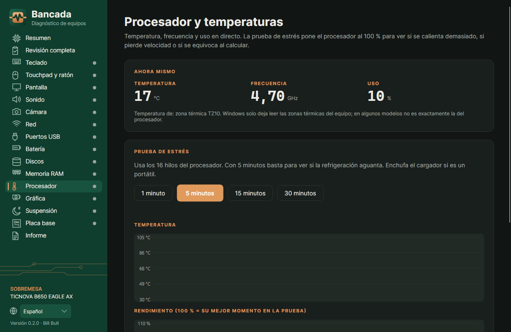
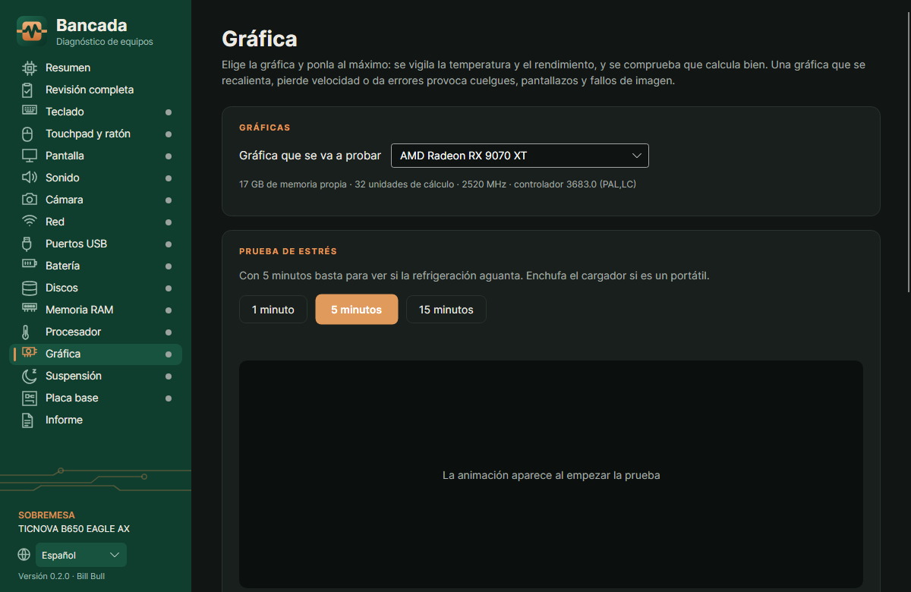
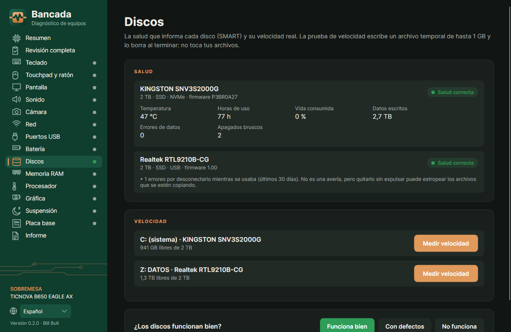
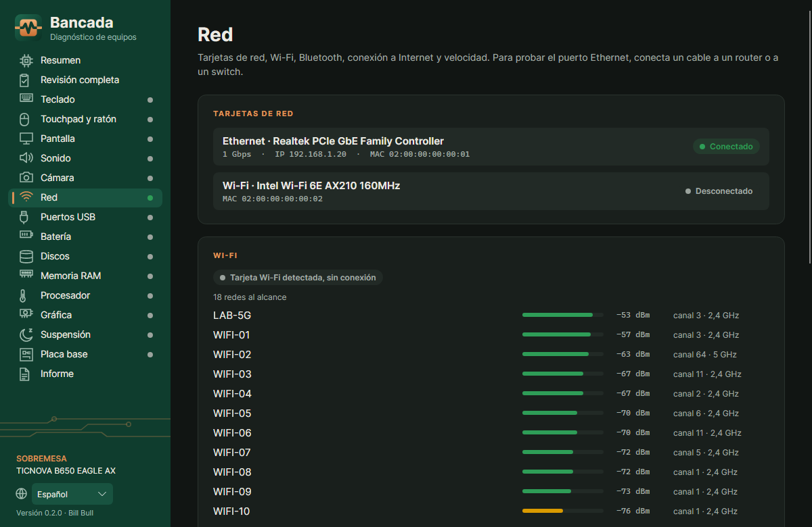

  

<h1 align="center">Bancada</h1>

  <b>Diagnóstico de hardware para técnicos y entusiastas.</b> 
  Portátiles y sobremesas · Windows y Linux · nativo, libre y gratuito

  
  
  

  <a href="README.md">English</a> · <b>Español</b> · <a href="README.pt.md">Português</a> · <a href="README.fr.md">Français</a> · <a href="README.de.md">Deutsch</a> · <a href="README.it.md">Italiano</a>

  <a href="https://bancada-hw.github.io/bancada/es/"><b>Web</b></a> ·
  <a href="docs/guia/es.md"><b>Guía de uso</b></a> ·
  <a href="https://github.com/bancada-hw/bancada/releases/latest"><b>Descargar</b></a> ·
  <a href="docs/desarrollo/es.md">Compilar y traducir</a>

---

Bancada es una mesa de trabajo en un solo archivo: lo abres en el equipo que estás revisando, ves qué
lleva dentro y vas comprobando que cada pieza funciona, desde el teclado hasta la gráfica. Al final te
da un **informe PDF** listo para entregar al cliente o archivar.

- **Nativo de verdad.** No es una web ni usa Electron. Un único ejecutable de unos 60 MB, sin instalar nada.
- **Sin cuentas, sin anuncios, sin telemetría.** No envía datos a nadie.
- **Hecho para el taller.** Una revisión completa guiada en unos 20 minutos, con veredicto por prueba.

  

## Descargar

| Sistema | Archivo | Cómo abrirlo |
|---|---|---|
| **Windows 10/11** (64 bits) | [Bancada-windows-x64.exe](https://github.com/bancada-hw/bancada/releases/latest/download/Bancada-windows-x64.exe) | Doble clic. Si sale «Windows protegió su PC», pulsa *Más información › Ejecutar de todas formas* (el ejecutable aún no está firmado). |
| **Linux** (64 bits) | [Bancada-linux-x64](https://github.com/bancada-hw/bancada/releases/latest/download/Bancada-linux-x64) | `chmod +x Bancada-linux-x64 && ./Bancada-linux-x64` |

Sin permisos de administrador funciona casi todo. Con ellos (o con `sudo` en Linux) se ven además los
módulos de RAM, el número de serie y los datos SMART completos de los discos SATA.

## Qué comprueba

| | Prueba | Qué hace |
|---|---|---|
| 🧾 | **Resumen** | Marca, modelo y serie, tipo de equipo, procesador, RAM por ranura, gráficas, discos, batería, placa y BIOS. |
| 🧭 | **Revisión completa** | Te guía por las pruebas manuales mientras hace solas las automáticas en segundo plano. |
| ⌨️ | **Teclado** | Teclado dibujado con su forma real (ISO, ANSI, ABNT2): cada tecla que llega se ilumina. 9 distribuciones. |
| 🖱️ | **Touchpad y ratón** | Zona que se colorea al pasar, botones, gestos, rueda, botones laterales, pantalla táctil y lápiz. |
| 🖥️ | **Pantalla** | Colores lisos, degradados y cuadrícula a pantalla completa para píxeles muertos, manchas y fugas de luz. |
| 🔊 | **Sonido** | Altavoz izquierdo y derecho, barrido de graves a agudos, nivel del micrófono y grabar y escuchar. |
| 📷 | **Cámara** | Imagen en directo de cada cámara; avisa si sale negra (tapa de privacidad). Nada se guarda. |
| 🌐 | **Red** | Tarjetas, Wi-Fi y redes cercanas, Bluetooth, conexión por pasos y velocidad de Internet. |
| 🔌 | **Puertos USB** | Marca cada puerto que responde y su velocidad real; detecta USB 3 funcionando como USB 2. |
| 🔋 | **Batería y cargador** | Salud y ciclos, consumo en directo, prueba de descarga con autonomía real y prueba del cargador. |
| 💽 | **Discos** | Salud SMART, errores registrados por el sistema y velocidad real de lectura y escritura. |
| 🧠 | **Memoria RAM** | 8 patrones sobre toda la memoria libre, comprobando cada bit. |
| 🌡️ | **Procesador** | Temperaturas, frecuencia y estrés con detección de sobrecalentamiento, estrangulamiento y errores de cálculo. |
| 🎮 | **Gráfica** | Estrés de cualquier gráfica (dedicada o integrada) con cálculo comprobado y prueba de la memoria de vídeo. |
| 🌙 | **Suspensión** | Suspende y despierta el equipo y comprueba que vuelven la red y los dispositivos. |
| 🧩 | **Placa base** | Firmware, TPM, dispositivos con fallos, enlaces PCI Express, errores de hardware y pila CMOS. |
| 📄 | **Informe** | Todo lo anterior en un PDF A4 con medidas, observaciones y veredictos. |

Cada prueba acaba con un veredicto: **Funciona bien**, **Con defectos** o **No funciona**. Las automáticas
lo proponen solas y tú decides. La [guía de uso](docs/guia/es.md) explica cada una paso a paso.

<table>
  <tr>
    <td></td>
    <td></td>
  </tr>
  <tr>
    <td></td>
    <td></td>
  </tr>
  <tr>
    <td></td>
    <td></td>
  </tr>
</table>

## Idiomas

Español, inglés, portugués de Brasil, francés, alemán e italiano. Usa el idioma del sistema y se cambia
en la barra lateral. El informe sale en el idioma elegido. ¿Quieres añadir el tuyo? Mira
[cómo traducir](docs/desarrollo/es.md#traducir-bancada-a-otro-idioma): no hace falta programar.

## Apoyar el proyecto

Bancada es gratis y lo seguirá siendo. Si te ahorra tiempo en el taller, puedes ayudar a mantenerlo con
un donativo, contando qué falla en
[Issues](https://github.com/bancada-hw/bancada/issues) o traduciéndolo a tu idioma.

## Licencia

Copyright © 2026 Bill Bull. Software libre con licencia [GPL-3.0 o posterior](LICENSE), con las
condiciones adicionales de [AVISO.md](AVISO.md): las versiones distribuidas deben mencionar el proyecto
original, indicar si están modificadas y no usar el nombre ni el logotipo de Bancada.

Hecho con [.NET](https://dotnet.microsoft.com), [Avalonia UI](https://avaloniaui.net),
[SkiaSharp](https://github.com/mono/SkiaSharp) y la fuente [Inter](https://rsms.me/inter/).
