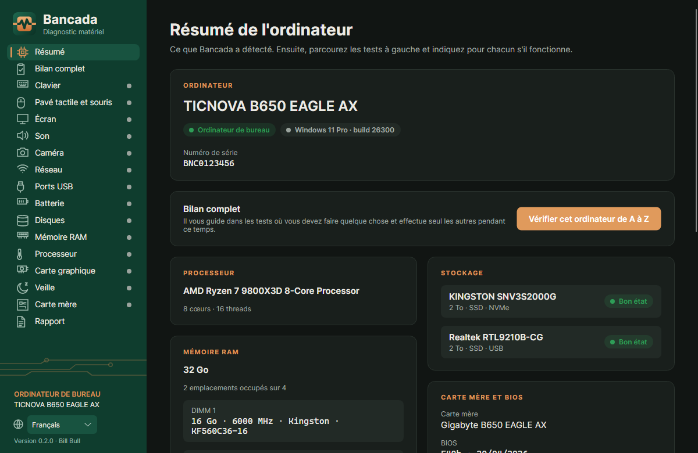
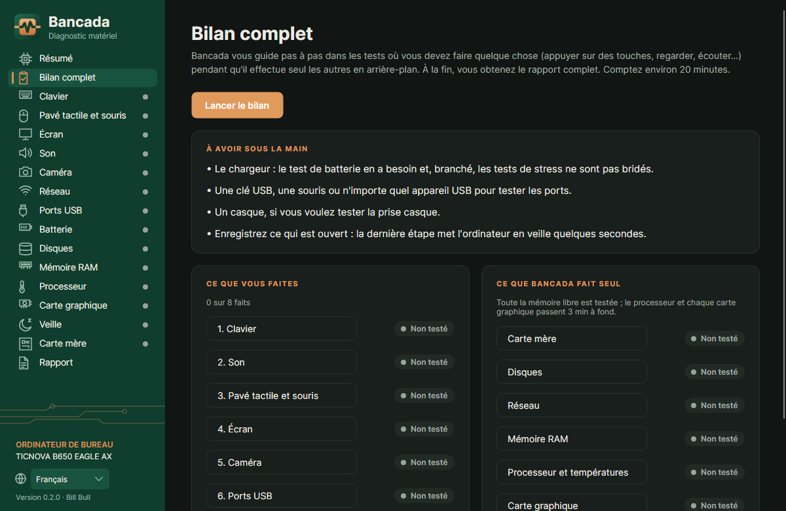
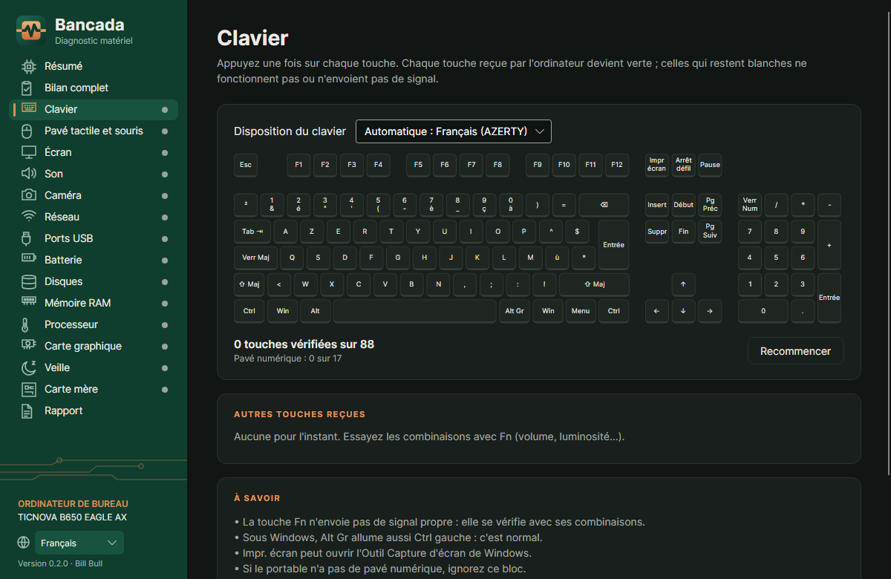
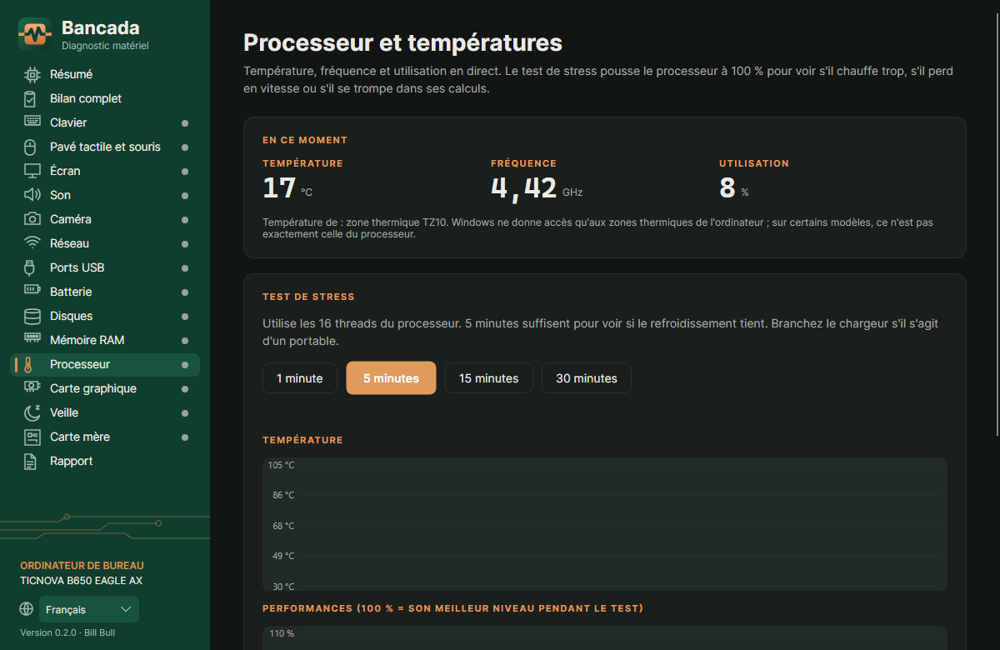
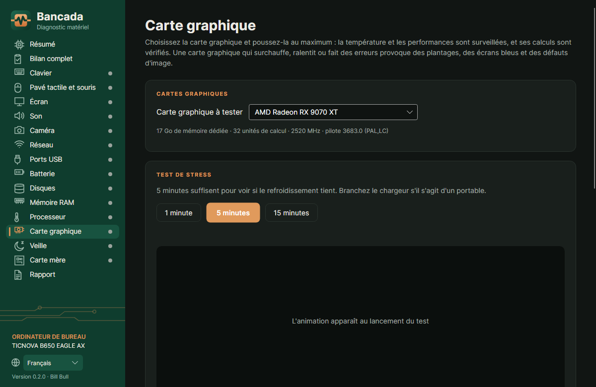
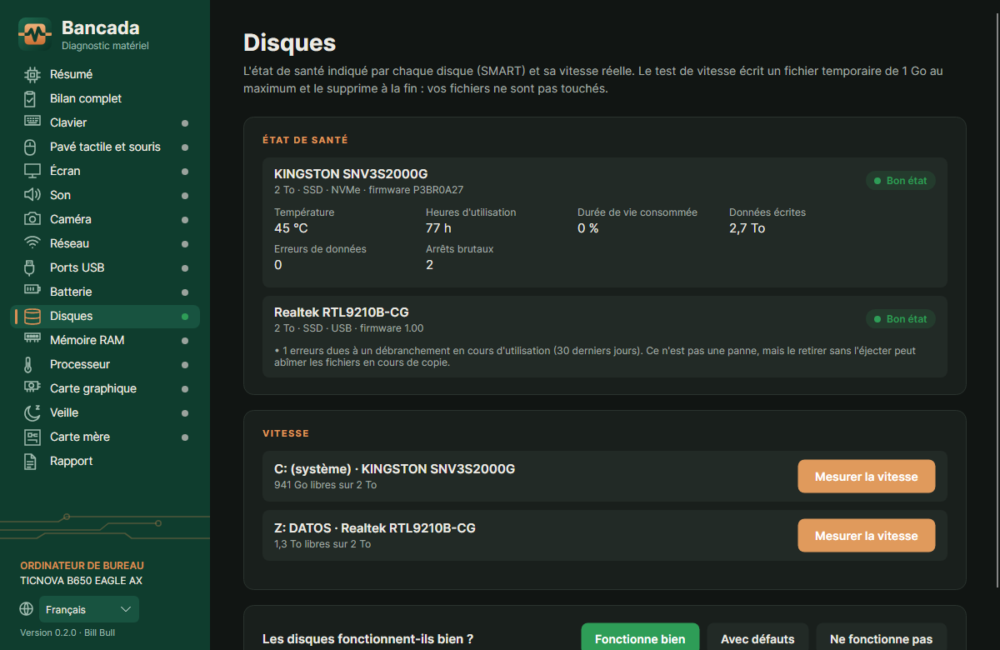
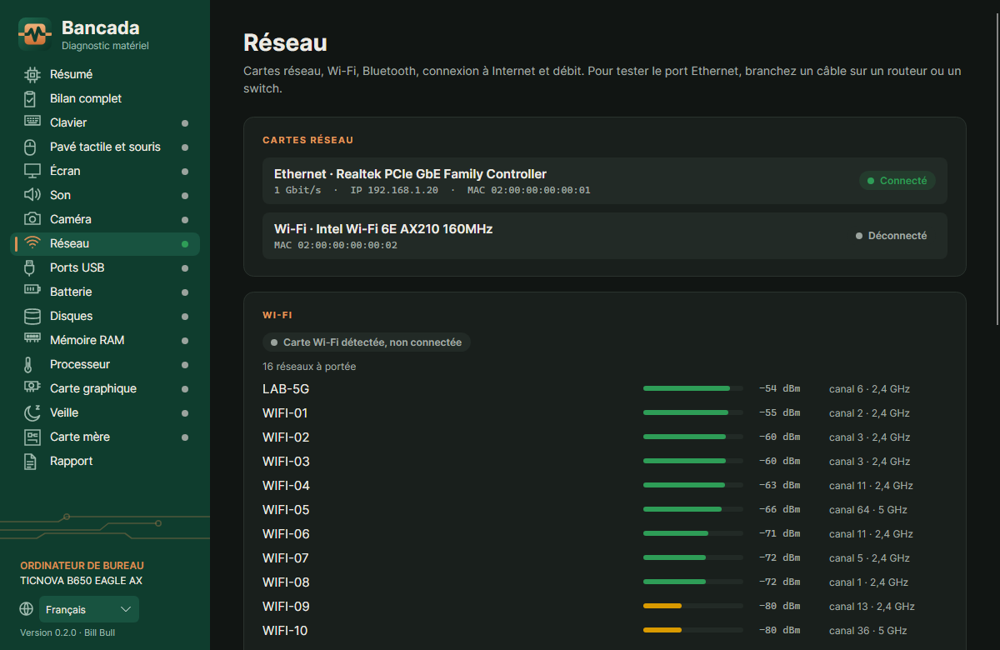

  

<h1 align="center">Bancada</h1>

  <b>Diagnostic matériel pour techniciens et passionnés.</b> 
  Portables et ordinateurs fixes · Windows et Linux · natif, libre et gratuit

  
  
  

  <a href="README.md">English</a> · <a href="README.es.md">Español</a> · <a href="README.pt.md">Português</a> · <b>Français</b> · <a href="README.de.md">Deutsch</a> · <a href="README.it.md">Italiano</a>

  <a href="https://bancada-hw.github.io/bancada/fr/"><b>Site web</b></a> ·
  <a href="docs/guia/fr.md"><b>Guide d'utilisation</b></a> ·
  <a href="https://github.com/bancada-hw/bancada/releases/latest"><b>Télécharger</b></a> ·
  <a href="docs/desarrollo/fr.md">Compiler et traduire</a>

---

Bancada (« établi » en espagnol) est un établi dans un seul fichier : vous l'ouvrez sur l'ordinateur à
contrôler, vous voyez ce qu'il contient et vous vérifiez chaque pièce, du clavier à la carte graphique.
À la fin, vous obtenez un **rapport PDF** prêt à remettre au client ou à archiver.

- **Vraiment natif.** Ni site web ni Electron. Un seul exécutable d'environ 60 Mo, rien à installer.
- **Sans compte, sans publicité, sans télémétrie.** Aucune donnée n'est envoyée.
- **Pensé pour l'atelier.** Un bilan complet guidé en 20 minutes environ, avec un verdict par test.

  

## Télécharger

| Système | Fichier | Comment l'ouvrir |
|---|---|---|
| **Windows 10/11** (64 bits) | [Bancada-windows-x64.exe](https://github.com/bancada-hw/bancada/releases/latest/download/Bancada-windows-x64.exe) | Double-clic. Si « Windows a protégé votre ordinateur » s'affiche, cliquez sur *Informations complémentaires › Exécuter quand même* (l'exécutable n'est pas encore signé). |
| **Linux** (64 bits) | [Bancada-linux-x64](https://github.com/bancada-hw/bancada/releases/latest/download/Bancada-linux-x64) | `chmod +x Bancada-linux-x64 && ./Bancada-linux-x64` |

Presque tout fonctionne sans droits d'administrateur. Avec eux (ou `sudo` sous Linux), vous voyez aussi les
barrettes de RAM, le numéro de série et les données SMART complètes des disques SATA.

**Signature de code :** l'exécutable Windows est compilé sur GitHub Actions et sera signé avec le certificat de SignPath Foundation. Consultez la [politique de signature de code](https://bancada-hw.github.io/bancada/fr/firma/).

## Ce qu'il teste

| | Test | Ce qu'il fait |
|---|---|---|
| 🧾 | **Résumé** | Marque, modèle et numéro de série, type d'ordinateur, processeur, RAM par emplacement, cartes graphiques, disques, batterie, carte mère et BIOS. |
| 🧭 | **Bilan complet** | Vous guide dans les tests manuels pendant qu'il fait les tests automatiques en arrière-plan. |
| ⌨️ | **Clavier** | Clavier dessiné avec sa forme réelle (ISO, ANSI, ABNT2) : chaque touche reçue s'allume. 9 dispositions. |
| 🖱️ | **Pavé tactile et souris** | Zone qui se colore au passage, boutons, gestes, défilement, boutons latéraux, écran tactile et stylet. |
| 🖥️ | **Écran** | Couleurs unies, dégradés et grille en plein écran pour repérer pixels morts, taches et fuites de lumière. |
| 🔊 | **Son** | Haut-parleur gauche et droit, balayage des graves aux aigus, niveau du micro et enregistrer-réécouter. |
| 📷 | **Caméra** | Image en direct de chaque caméra ; avertit si elle est noire (cache de confidentialité). Rien n'est enregistré. |
| 🌐 | **Réseau** | Cartes, Wi-Fi et réseaux proches, Bluetooth, connexion étape par étape et débit Internet. |
| 🔌 | **Ports USB** | Marque chaque port qui répond et sa vitesse réelle ; détecte l'USB 3 qui fonctionne en USB 2. |
| 🔋 | **Batterie et chargeur** | Santé et cycles, consommation en direct, test de décharge avec autonomie réelle et test du chargeur. |
| 💽 | **Disques** | Santé SMART, erreurs enregistrées par le système et vitesse réelle de lecture et d'écriture. |
| 🧠 | **Mémoire RAM** | 8 motifs sur toute la mémoire libre, en vérifiant chaque bit. |
| 🌡️ | **Processeur** | Températures, fréquence et test de stress qui détecte surchauffe, bridage thermique et erreurs de calcul. |
| 🎮 | **Carte graphique** | Stress de n'importe quelle carte (dédiée ou intégrée) avec calcul vérifié et test de la mémoire vidéo. |
| 🌙 | **Veille** | Met l'ordinateur en veille, le réveille et vérifie que réseau et périphériques reviennent. |
| 🧩 | **Carte mère** | Firmware, TPM, périphériques en panne, liens PCI Express, erreurs matérielles et pile CMOS. |
| 📄 | **Rapport** | Tout cela dans un PDF A4 avec mesures, remarques et verdicts. |

Chaque test se termine par un verdict : **Fonctionne bien**, **Avec défauts** ou **Ne fonctionne pas**. Les
tests automatiques le proposent et vous décidez. Le [guide d'utilisation](docs/guia/fr.md) explique chacun
étape par étape.

<table>
  <tr>
    <td></td>
    <td></td>
  </tr>
  <tr>
    <td></td>
    <td></td>
  </tr>
  <tr>
    <td></td>
    <td></td>
  </tr>
</table>

## Langues

Espagnol, anglais, portugais du Brésil, français, allemand et italien. Il suit la langue du système et se
change dans la barre latérale. Le rapport sort dans la langue choisie. Vous voulez ajouter la vôtre ?
Voir [comment traduire](docs/desarrollo/fr.md#traduire-bancada) : pas besoin de programmer.

## Soutenir le projet

Bancada est gratuit et le restera. S'il vous fait gagner du temps à l'atelier, vous pouvez aider à le
maintenir par un [don](https://github.com/sponsors/bancada-hw), en signalant ce qui ne marche pas dans
[Issues](https://github.com/bancada-hw/bancada/issues) ou en le traduisant dans votre langue.

## Licence

Copyright © 2026 Bill Bull. Logiciel libre sous licence [GPL-3.0 ou ultérieure](LICENSE), avec les
conditions supplémentaires d'[AVISO.md](AVISO.md) : les versions distribuées doivent citer le projet
d'origine, indiquer si elles sont modifiées et ne pas utiliser le nom ni le logo de Bancada.

Réalisé avec [.NET](https://dotnet.microsoft.com), [Avalonia UI](https://avaloniaui.net),
[SkiaSharp](https://github.com/mono/SkiaSharp) et la police [Inter](https://rsms.me/inter/).
