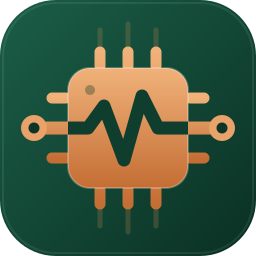
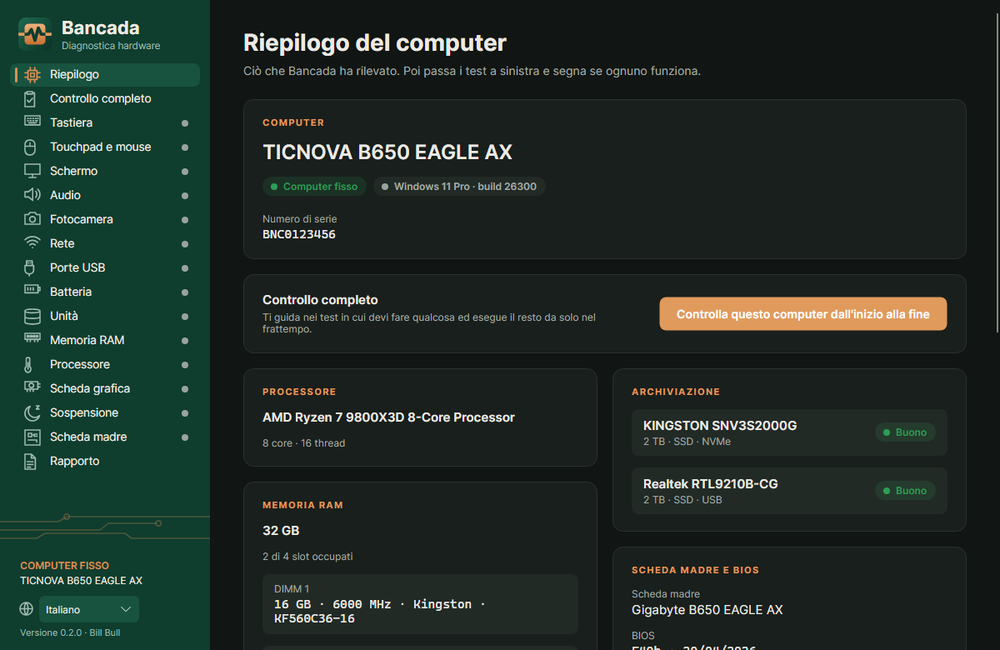
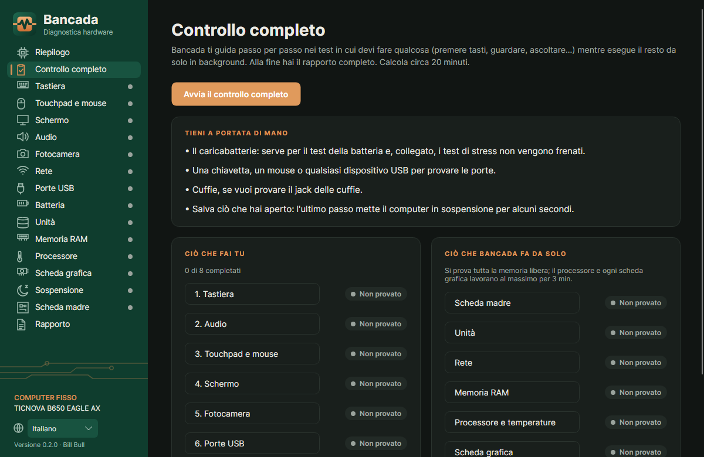
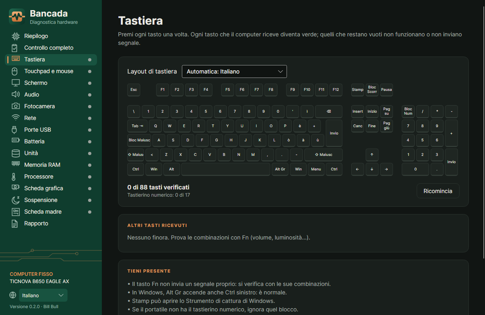
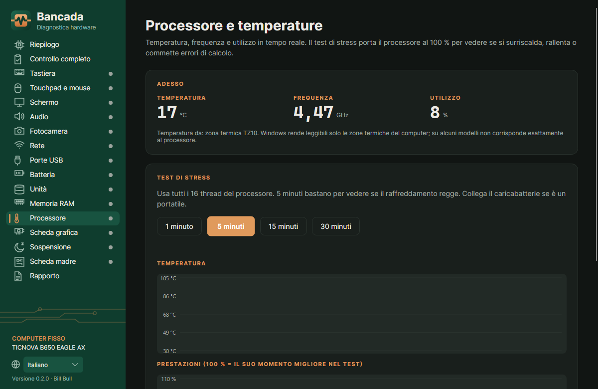
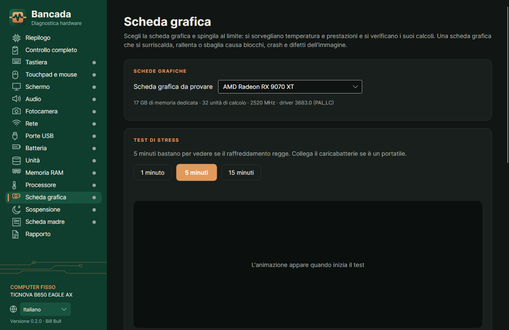
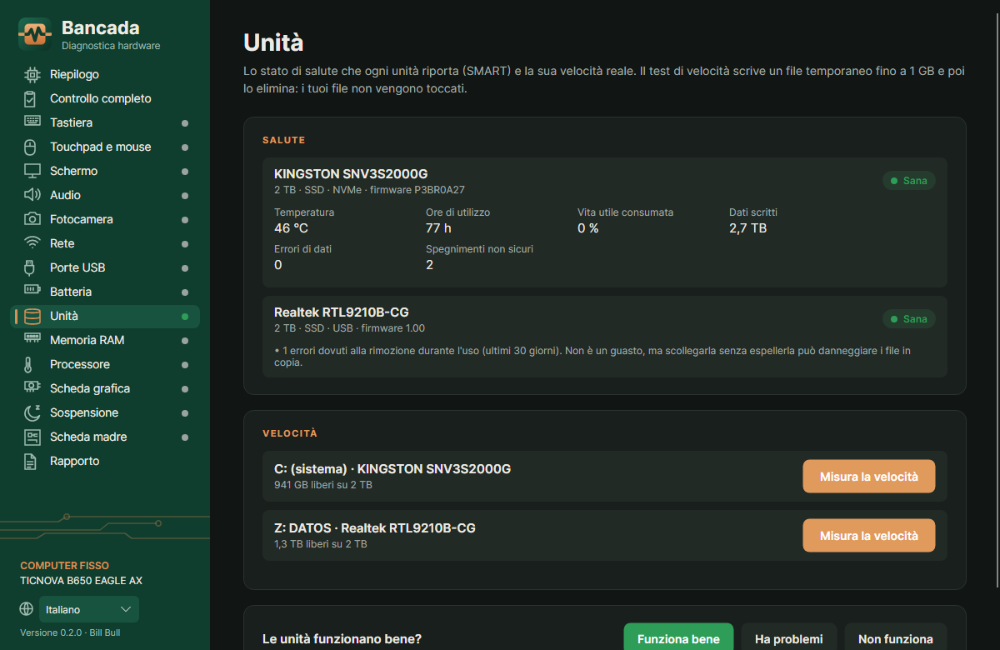
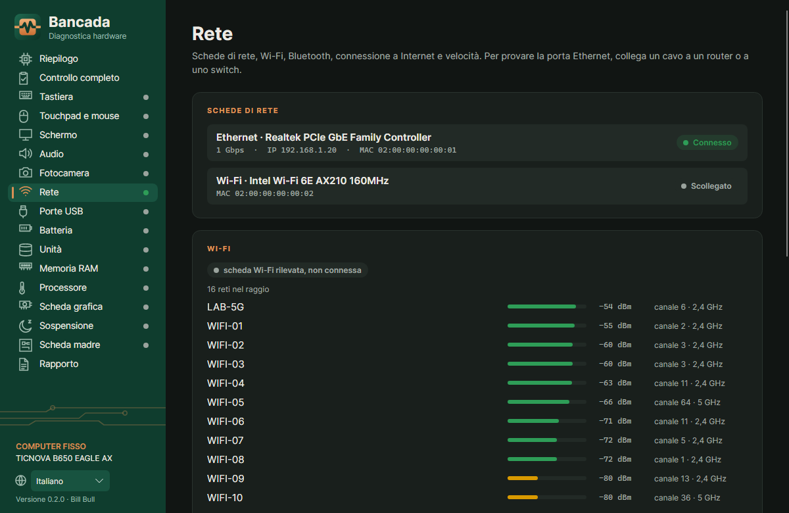

  

<h1 align="center">Bancada</h1>

  <b>Diagnostica hardware per tecnici e appassionati.</b> 
  Portatili e computer fissi · Windows e Linux · nativo, libero e gratuito

  
  
  

  <a href="README.md">English</a> · <a href="README.es.md">Español</a> · <a href="README.pt.md">Português</a> · <a href="README.fr.md">Français</a> · <a href="README.de.md">Deutsch</a> · <b>Italiano</b>

  <a href="https://bancada-hw.github.io/bancada/it/"><b>Sito</b></a> ·
  <a href="docs/guia/it.md"><b>Guida all'uso</b></a> ·
  <a href="https://github.com/bancada-hw/bancada/releases/latest"><b>Scarica</b></a> ·
  <a href="docs/desarrollo/it.md">Compilare e tradurre</a>

---

Bancada («banco di lavoro» in spagnolo) è un banco di lavoro in un solo file: lo apri sul computer che
stai controllando, vedi cosa c'è dentro e verifichi ogni componente, dalla tastiera alla scheda grafica.
Alla fine ottieni un **rapporto PDF** pronto da consegnare al cliente o da archiviare.

- **Davvero nativo.** Non è un'app web e non usa Electron. Un solo eseguibile di circa 60 MB, niente da installare.
- **Niente account, pubblicità né telemetria.** Non invia dati a nessuno.
- **Pensato per il laboratorio.** Un controllo completo guidato in circa 20 minuti, con un verdetto per ogni test.

  

## Scarica

| Sistema | File | Come aprirlo |
|---|---|---|
| **Windows 10/11** (64 bit) | [Bancada-windows-x64.exe](https://github.com/bancada-hw/bancada/releases/latest/download/Bancada-windows-x64.exe) | Doppio clic. Se compare «PC protetto da Windows», fai clic su *Ulteriori informazioni › Esegui comunque* (l'eseguibile non è ancora firmato). |
| **Linux** (64 bit) | [Bancada-linux-x64](https://github.com/bancada-hw/bancada/releases/latest/download/Bancada-linux-x64) | `chmod +x Bancada-linux-x64 && ./Bancada-linux-x64` |

Quasi tutto funziona senza diritti di amministratore. Con essi (o con `sudo` su Linux) vedi anche i moduli
di RAM, il numero di serie e i dati SMART completi delle unità SATA.

## Cosa verifica

| | Test | Cosa fa |
|---|---|---|
| 🧾 | **Riepilogo** | Marca, modello e numero di serie, tipo di computer, processore, RAM per slot, schede grafiche, unità, batteria, scheda madre e BIOS. |
| 🧭 | **Controllo completo** | Ti guida nei test manuali mentre esegue quelli automatici in background. |
| ⌨️ | **Tastiera** | Tastiera disegnata con la sua forma reale (ISO, ANSI, ABNT2): ogni tasto ricevuto si accende. 9 layout. |
| 🖱️ | **Touchpad e mouse** | Area che si colora al passaggio, pulsanti, gesti, scorrimento, pulsanti laterali, schermo tattile e penna. |
| 🖥️ | **Schermo** | Colori pieni, sfumature e griglia a schermo intero per pixel morti, macchie e perdite di luce. |
| 🔊 | **Audio** | Altoparlante sinistro e destro, sweep dai bassi agli acuti, livello del microfono e registra-riascolta. |
| 📷 | **Fotocamera** | Immagine dal vivo di ogni fotocamera; avvisa se è nera (sportellino privacy). Non si salva nulla. |
| 🌐 | **Rete** | Schede, Wi-Fi e reti vicine, Bluetooth, connessione passo per passo e velocità di Internet. |
| 🔌 | **Porte USB** | Segna ogni porta che risponde e la sua velocità reale; rileva USB 3 che funziona come USB 2. |
| 🔋 | **Batteria e caricabatterie** | Salute e cicli, consumo dal vivo, test di scarica con autonomia reale e test del caricabatterie. |
| 💽 | **Unità** | Salute SMART, errori registrati dal sistema e velocità reale di lettura e scrittura. |
| 🧠 | **Memoria RAM** | 8 schemi su tutta la memoria libera, verificando ogni bit. |
| 🌡️ | **Processore** | Temperature, frequenza e test di stress che rileva surriscaldamento, throttling ed errori di calcolo. |
| 🎮 | **Scheda grafica** | Stress di qualsiasi scheda (dedicata o integrata) con calcoli verificati e test della memoria video. |
| 🌙 | **Sospensione** | Sospende e riattiva il computer e verifica che rete e dispositivi tornino. |
| 🧩 | **Scheda madre** | Firmware, TPM, dispositivi guasti, collegamenti PCI Express, errori hardware e batteria CMOS. |
| 📄 | **Rapporto** | Tutto questo in un PDF A4 con misure, note e verdetti. |

Ogni test termina con un verdetto: **Funziona bene**, **Ha problemi** o **Non funziona**. Quelli automatici
lo propongono e decidi tu. La [guida all'uso](docs/guia/it.md) spiega ogni test passo per passo.

<table>
  <tr>
    <td></td>
    <td></td>
  </tr>
  <tr>
    <td></td>
    <td></td>
  </tr>
  <tr>
    <td></td>
    <td></td>
  </tr>
</table>

## Lingue

Spagnolo, inglese, portoghese brasiliano, francese, tedesco e italiano. Segue la lingua del sistema e si
cambia nella barra laterale. Il rapporto esce nella lingua scelta. Vuoi aggiungere la tua? Vedi
[come tradurre](docs/desarrollo/it.md#tradurre-bancada): non serve programmare.

## Sostieni il progetto

Bancada è gratuito e lo resterà. Se ti fa risparmiare tempo al banco, puoi aiutare a mantenerlo con una
donazione, segnalando cosa non va in
[Issues](https://github.com/bancada-hw/bancada/issues) o traducendolo nella tua lingua.

## Licenza

Copyright © 2026 Bill Bull. Software libero con licenza [GPL-3.0 o successiva](LICENSE), con le condizioni
aggiuntive di [AVISO.md](AVISO.md): le versioni distribuite devono citare il progetto originale, indicare se
sono modificate e non usare il nome né il logo di Bancada.

Realizzato con [.NET](https://dotnet.microsoft.com), [Avalonia UI](https://avaloniaui.net),
[SkiaSharp](https://github.com/mono/SkiaSharp) e il carattere [Inter](https://rsms.me/inter/).
