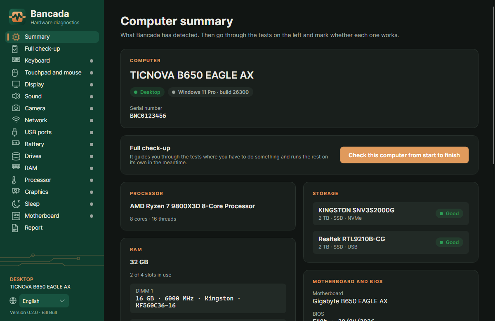
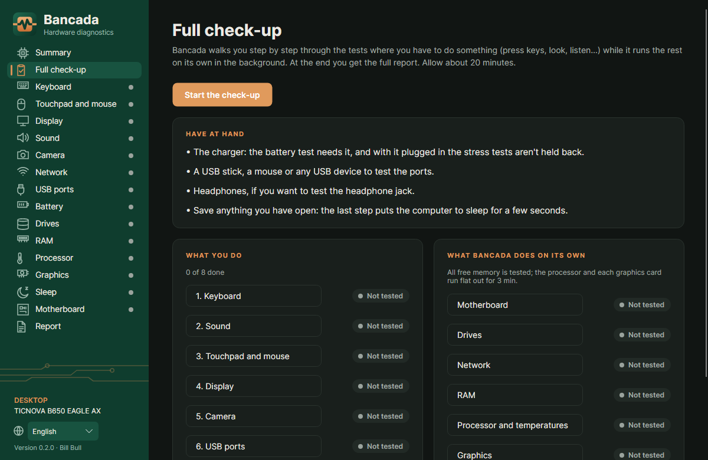
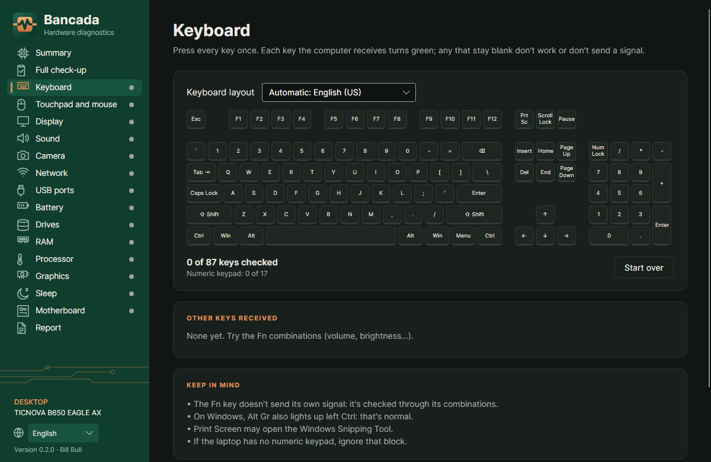
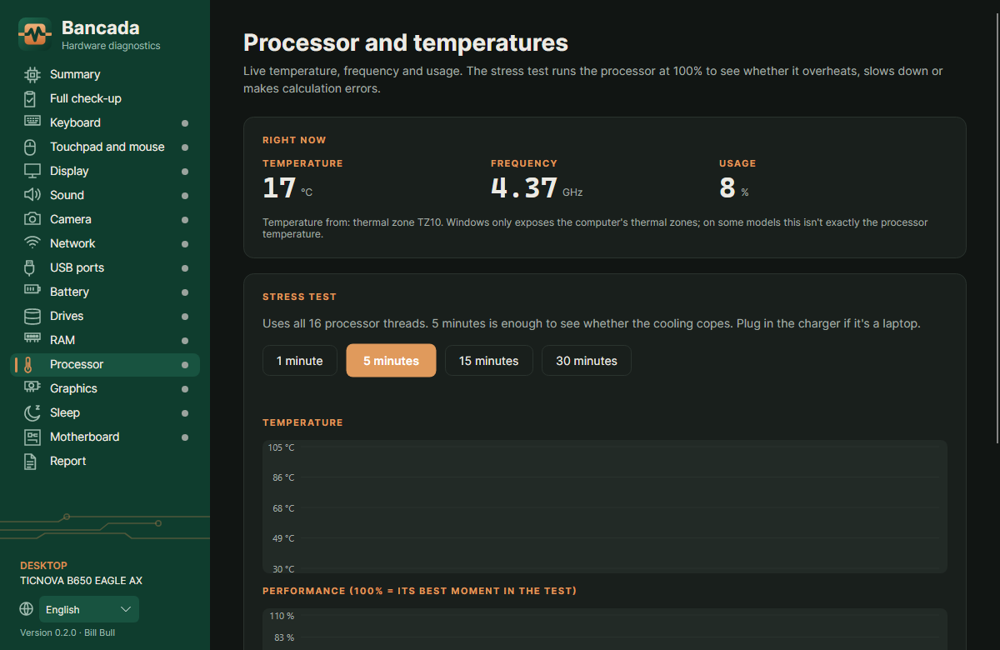
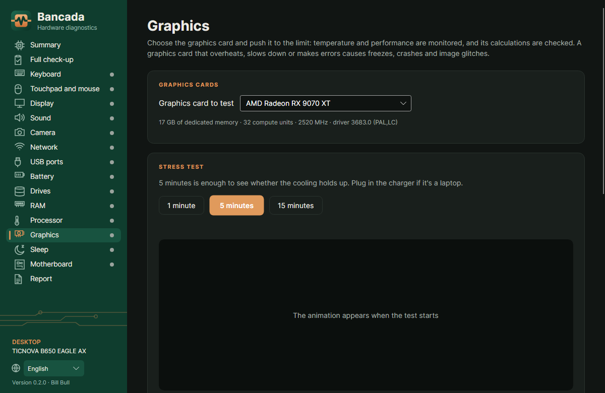
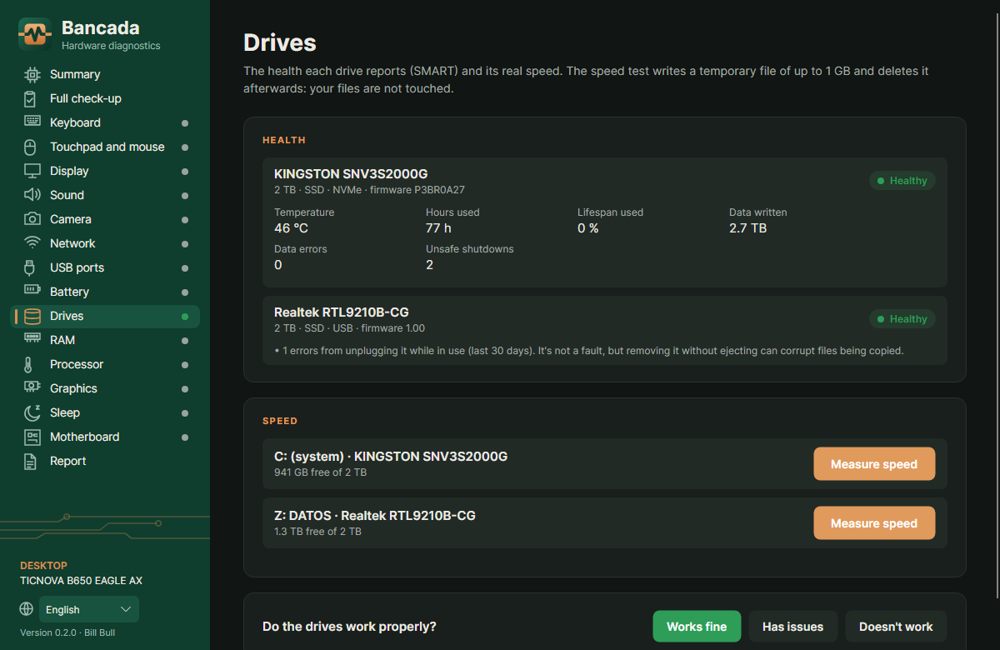
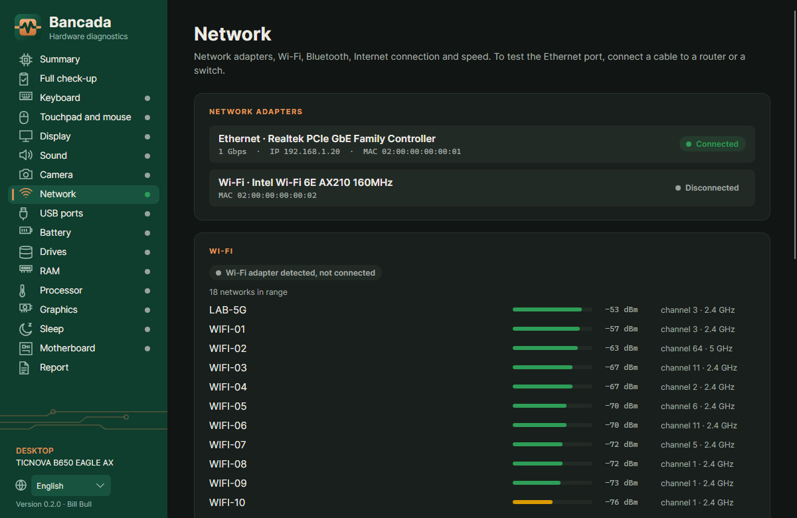

  

<h1 align="center">Bancada</h1>

  <b>Hardware diagnostics for technicians and enthusiasts.</b> 
  Laptops and desktops · Windows and Linux · native, free and open source

  
  
  

  <b>English</b> · <a href="README.es.md">Español</a> · <a href="README.pt.md">Português</a> · <a href="README.fr.md">Français</a> · <a href="README.de.md">Deutsch</a> · <a href="README.it.md">Italiano</a>

  <a href="https://bancada-hw.github.io/bancada/en/"><b>Website</b></a> ·
  <a href="docs/guia/en.md"><b>User guide</b></a> ·
  <a href="https://github.com/bancada-hw/bancada/releases/latest"><b>Download</b></a> ·
  <a href="docs/desarrollo/en.md">Build and translate</a>

---

Bancada (Spanish for *workbench*) is a repair bench in a single file: open it on the computer you're
checking, see what's inside and test every part, from the keyboard to the graphics card. At the end you
get a **PDF report** ready to hand to the customer or keep on file.

- **Truly native.** Not a web app, no Electron. A single executable of about 60 MB, nothing to install.
- **No accounts, no ads, no telemetry.** It doesn't send data anywhere.
- **Built for the workshop.** A guided full check-up in about 20 minutes, with a verdict for every test.

  

## Download

| System | File | How to open it |
|---|---|---|
| **Windows 10/11** (64-bit) | [Bancada-windows-x64.exe](https://github.com/bancada-hw/bancada/releases/latest/download/Bancada-windows-x64.exe) | Double-click. If you see "Windows protected your PC", click *More info › Run anyway* (the executable isn't signed yet). |
| **Linux** (64-bit) | [Bancada-linux-x64](https://github.com/bancada-hw/bancada/releases/latest/download/Bancada-linux-x64) | `chmod +x Bancada-linux-x64 && ./Bancada-linux-x64` |

Almost everything works without administrator rights. With them (or `sudo` on Linux) you also get the RAM
modules, the serial number and full SMART data for SATA drives.

## What it tests

| | Test | What it does |
|---|---|---|
| 🧾 | **Summary** | Make, model and serial, computer type, processor, RAM per slot, graphics, drives, battery, motherboard and BIOS. |
| 🧭 | **Full check-up** | Guides you through the hands-on tests while running the automatic ones in the background. |
| ⌨️ | **Keyboard** | Keyboard drawn with its real shape (ISO, ANSI, ABNT2): every key received lights up. 9 layouts. |
| 🖱️ | **Touchpad and mouse** | Area that fills as you move, buttons, gestures, scroll, side buttons, touchscreen and pen. |
| 🖥️ | **Display** | Full-screen solid colours, gradients and grid to spot dead pixels, blotches and backlight bleed. |
| 🔊 | **Sound** | Left and right speaker, low-to-high sweep, live microphone level and record-and-play. |
| 📷 | **Camera** | Live picture from every camera; warns if it's black (privacy shutter). Nothing is saved. |
| 🌐 | **Network** | Adapters, Wi-Fi and nearby networks, Bluetooth, step-by-step connection check and Internet speed. |
| 🔌 | **USB ports** | Marks every port that responds and its real speed; spots USB 3 devices running at USB 2. |
| 🔋 | **Battery and charger** | Health and cycles, live power draw, discharge test with real battery life and charger test. |
| 💽 | **Drives** | SMART health, errors logged by the system and real read and write speed. |
| 🧠 | **RAM** | 8 patterns across all free memory, checking every bit. |
| 🌡️ | **Processor** | Temperatures, frequency and a stress test that detects overheating, throttling and calculation errors. |
| 🎮 | **Graphics** | Stress any graphics card (dedicated or integrated) with verified calculations, plus a video memory test. |
| 🌙 | **Sleep** | Puts the computer to sleep, wakes it and checks that network and devices come back. |
| 🧩 | **Motherboard** | Firmware, TPM, faulty devices, PCI Express links, hardware errors and CMOS battery. |
| 📄 | **Report** | All of the above in an A4 PDF with measurements, notes and verdicts. |

Every test ends with a verdict: **Works fine**, **Has issues** or **Doesn't work**. Automatic tests propose
one and you decide. The [user guide](docs/guia/en.md) explains each test step by step.

<table>
  <tr>
    <td></td>
    <td></td>
  </tr>
  <tr>
    <td></td>
    <td></td>
  </tr>
  <tr>
    <td></td>
    <td></td>
  </tr>
</table>

## Languages

Spanish, English, Brazilian Portuguese, French, German and Italian. It follows the system language and can
be changed in the sidebar. The report comes out in the chosen language. Want to add yours? See
[how to translate](docs/desarrollo/en.md#translating-bancada): no programming needed.

## Support the project

Bancada is free and will stay free. If it saves you time at the bench, you can help keep it going with a
[donation](https://github.com/sponsors/bancada-hw), by reporting what fails in
[Issues](https://github.com/bancada-hw/bancada/issues) or by translating it into your language.

## License

Copyright © 2026 Bill Bull. Free software under the [GPL-3.0-or-later](LICENSE), with the additional terms
in [AVISO.md](AVISO.md): distributed versions must credit the original project, say whether they are
modified and not use the Bancada name or logo.

Built with [.NET](https://dotnet.microsoft.com), [Avalonia UI](https://avaloniaui.net),
[SkiaSharp](https://github.com/mono/SkiaSharp) and the [Inter](https://rsms.me/inter/) typeface.
