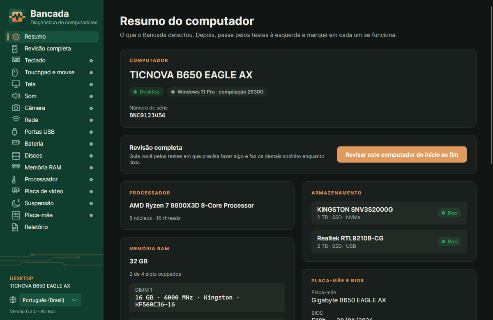
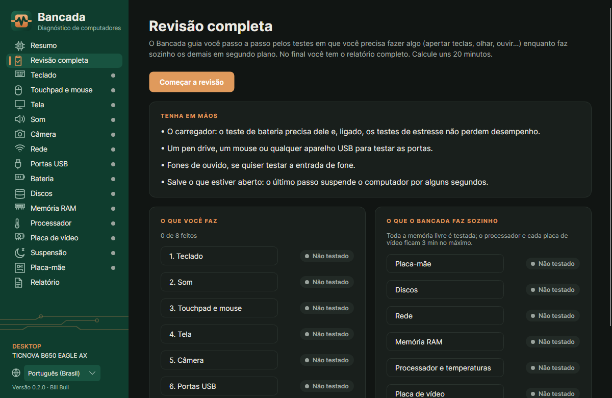
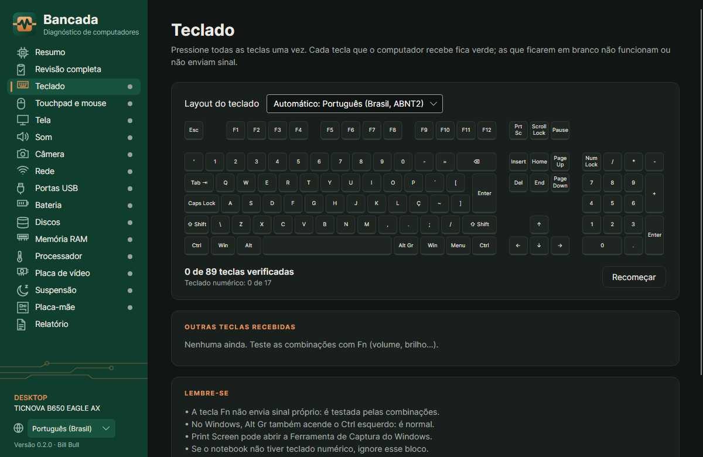
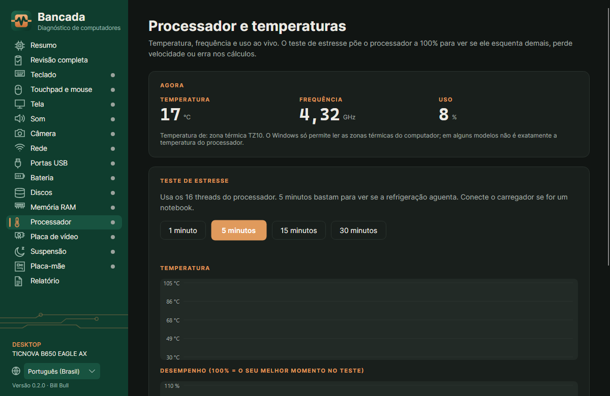
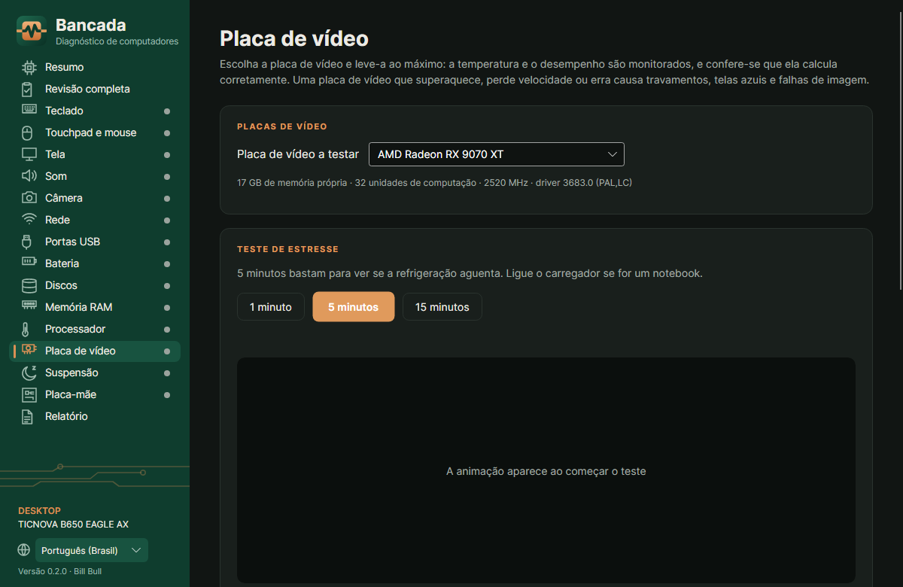
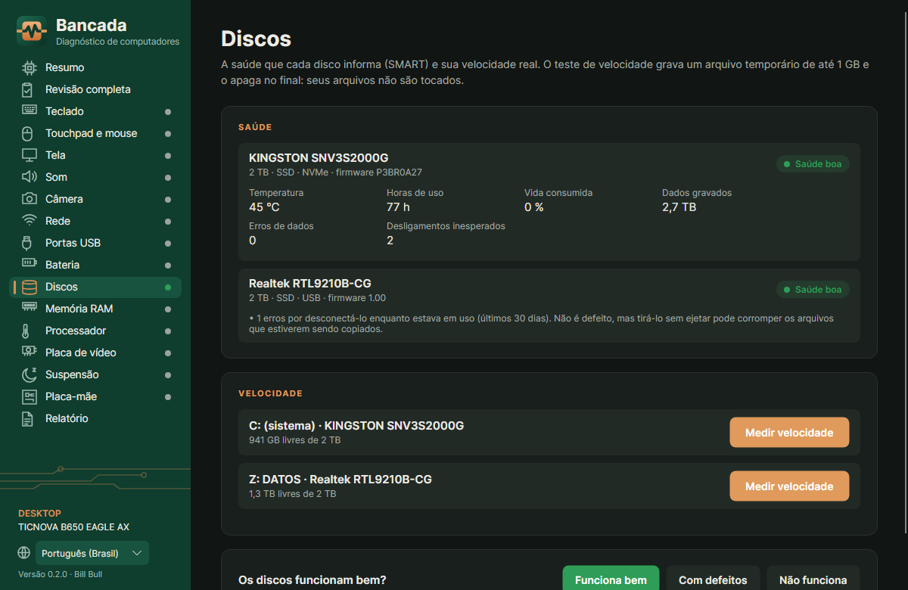
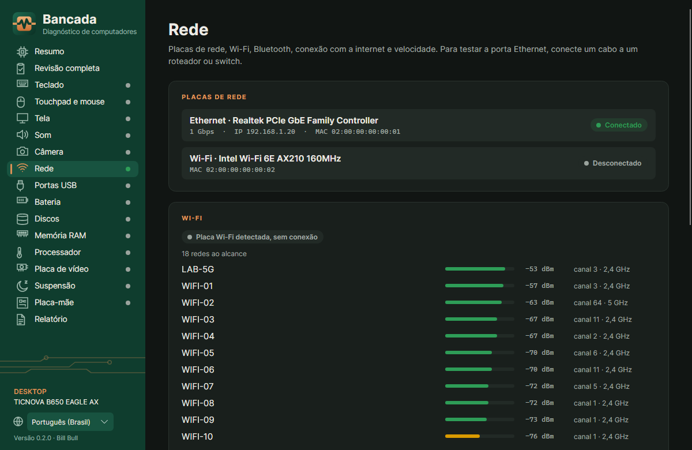

  

<h1 align="center">Bancada</h1>

  <b>Diagnóstico de hardware para técnicos e entusiastas.</b> 
  Notebooks e desktops · Windows e Linux · nativo, livre e gratuito

  
  
  

  <a href="README.md">English</a> · <a href="README.es.md">Español</a> · <b>Português</b> · <a href="README.fr.md">Français</a> · <a href="README.de.md">Deutsch</a> · <a href="README.it.md">Italiano</a>

  <a href="https://bancada-hw.github.io/bancada/pt/"><b>Site</b></a> ·
  <a href="docs/guia/pt.md"><b>Guia de uso</b></a> ·
  <a href="https://github.com/bancada-hw/bancada/releases/latest"><b>Baixar</b></a> ·
  <a href="docs/desarrollo/pt.md">Compilar e traduzir</a>

---

Bancada é uma bancada de trabalho em um único arquivo: você o abre no computador que está revisando, vê o
que ele tem dentro e testa cada peça, do teclado à placa de vídeo. No final, recebe um **relatório em PDF**
pronto para entregar ao cliente ou arquivar.

- **Nativo de verdade.** Não é um site nem usa Electron. Um único executável de uns 60 MB, sem instalar nada.
- **Sem contas, sem anúncios, sem telemetria.** Não envia dados para ninguém.
- **Feito para a oficina.** Uma revisão completa guiada em uns 20 minutos, com veredito para cada teste.

  

## Baixar

| Sistema | Arquivo | Como abrir |
|---|---|---|
| **Windows 10/11** (64 bits) | [Bancada-windows-x64.exe](https://github.com/bancada-hw/bancada/releases/latest/download/Bancada-windows-x64.exe) | Clique duas vezes. Se aparecer «O Windows protegeu o computador», clique em *Mais informações › Executar assim mesmo* (o executável ainda não é assinado). |
| **Linux** (64 bits) | [Bancada-linux-x64](https://github.com/bancada-hw/bancada/releases/latest/download/Bancada-linux-x64) | `chmod +x Bancada-linux-x64 && ./Bancada-linux-x64` |

Quase tudo funciona sem permissões de administrador. Com elas (ou com `sudo` no Linux) você vê também os
módulos de RAM, o número de série e os dados SMART completos dos discos SATA.

**Assinatura de código:** o executável do Windows é compilado no GitHub Actions e será assinado com o certificado da SignPath Foundation. Veja a [política de assinatura de código](https://bancada-hw.github.io/bancada/pt/firma/).

## O que testa

| | Teste | O que faz |
|---|---|---|
| 🧾 | **Resumo** | Marca, modelo e série, tipo de computador, processador, RAM por slot, placas de vídeo, discos, bateria, placa-mãe e BIOS. |
| 🧭 | **Revisão completa** | Guia você pelos testes manuais enquanto faz os automáticos em segundo plano. |
| ⌨️ | **Teclado** | Teclado desenhado com o formato real (ISO, ANSI, ABNT2): cada tecla recebida se acende. 9 layouts. |
| 🖱️ | **Touchpad e mouse** | Área que se colore ao passar, botões, gestos, rolagem, botões laterais, tela sensível ao toque e caneta. |
| 🖥️ | **Tela** | Cores sólidas, degradês e grade em tela cheia para pixels mortos, manchas e vazamentos de luz. |
| 🔊 | **Som** | Alto-falante esquerdo e direito, varredura de graves a agudos, nível do microfone e gravar e ouvir. |
| 📷 | **Câmera** | Imagem ao vivo de cada câmera; avisa se sai preta (tampa de privacidade). Nada é salvo. |
| 🌐 | **Rede** | Placas, Wi-Fi e redes próximas, Bluetooth, conexão passo a passo e velocidade da internet. |
| 🔌 | **Portas USB** | Marca cada porta que responde e sua velocidade real; detecta USB 3 funcionando como USB 2. |
| 🔋 | **Bateria e carregador** | Saúde e ciclos, consumo ao vivo, teste de descarga com autonomia real e teste do carregador. |
| 💽 | **Discos** | Saúde SMART, erros registrados pelo sistema e velocidade real de leitura e gravação. |
| 🧠 | **Memória RAM** | 8 padrões em toda a memória livre, verificando cada bit. |
| 🌡️ | **Processador** | Temperaturas, frequência e teste de estresse que detecta superaquecimento, throttling e erros de cálculo. |
| 🎮 | **Placa de vídeo** | Estresse de qualquer placa (dedicada ou integrada) com cálculo verificado e teste da memória de vídeo. |
| 🌙 | **Suspensão** | Suspende e acorda o computador e verifica se rede e dispositivos voltam. |
| 🧩 | **Placa-mãe** | Firmware, TPM, dispositivos com falha, links PCI Express, erros de hardware e bateria CMOS. |
| 📄 | **Relatório** | Tudo isso em um PDF A4 com medições, observações e vereditos. |

Cada teste termina com um veredito: **Funciona bem**, **Com defeitos** ou **Não funciona**. Os automáticos o
propõem sozinhos e você decide. O [guia de uso](docs/guia/pt.md) explica cada um passo a passo.

<table>
  <tr>
    <td></td>
    <td></td>
  </tr>
  <tr>
    <td></td>
    <td></td>
  </tr>
  <tr>
    <td></td>
    <td></td>
  </tr>
</table>

## Idiomas

Espanhol, inglês, português do Brasil, francês, alemão e italiano. Usa o idioma do sistema e pode ser
trocado na barra lateral. O relatório sai no idioma escolhido. Quer adicionar o seu? Veja
[como traduzir](docs/desarrollo/pt.md#traduzir-a-bancada): não é preciso programar.

## Apoie o projeto

Bancada é gratuito e continuará sendo. Se ele poupa seu tempo na bancada, você pode ajudar a mantê-lo com
uma [doação](https://github.com/sponsors/bancada-hw), relatando o que falha em
[Issues](https://github.com/bancada-hw/bancada/issues) ou traduzindo-o para o seu idioma.

## Licença

Copyright © 2026 Bill Bull. Software livre sob a licença [GPL-3.0 ou posterior](LICENSE), com as condições
adicionais de [AVISO.md](AVISO.md): as versões distribuídas devem mencionar o projeto original, indicar se
foram modificadas e não usar o nome nem o logotipo da Bancada.

Feito com [.NET](https://dotnet.microsoft.com), [Avalonia UI](https://avaloniaui.net),
[SkiaSharp](https://github.com/mono/SkiaSharp) e a fonte [Inter](https://rsms.me/inter/).
