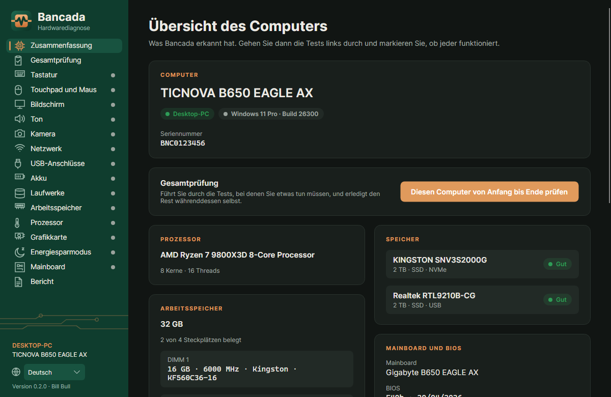
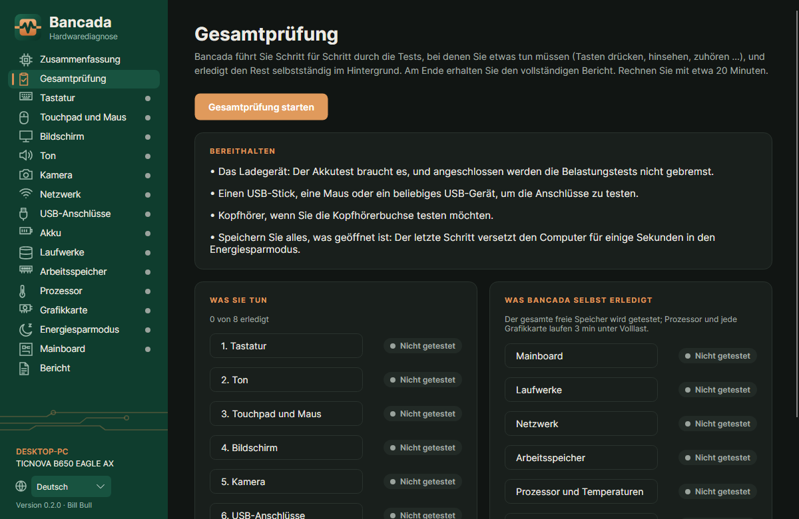
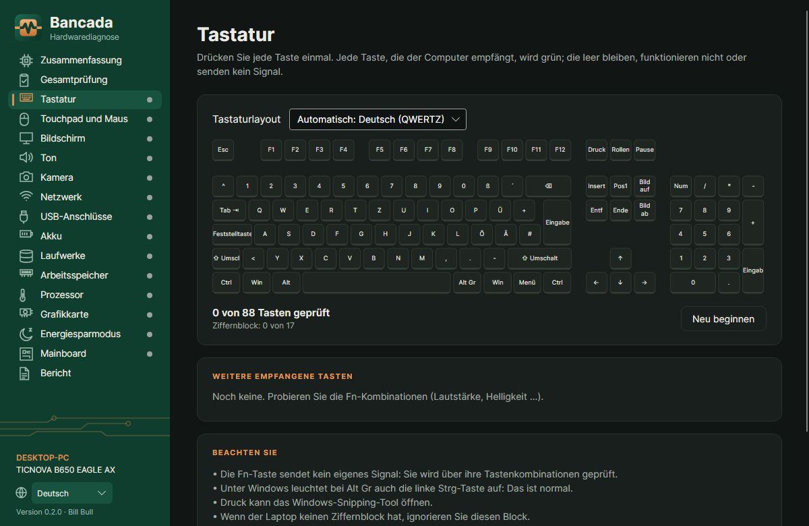
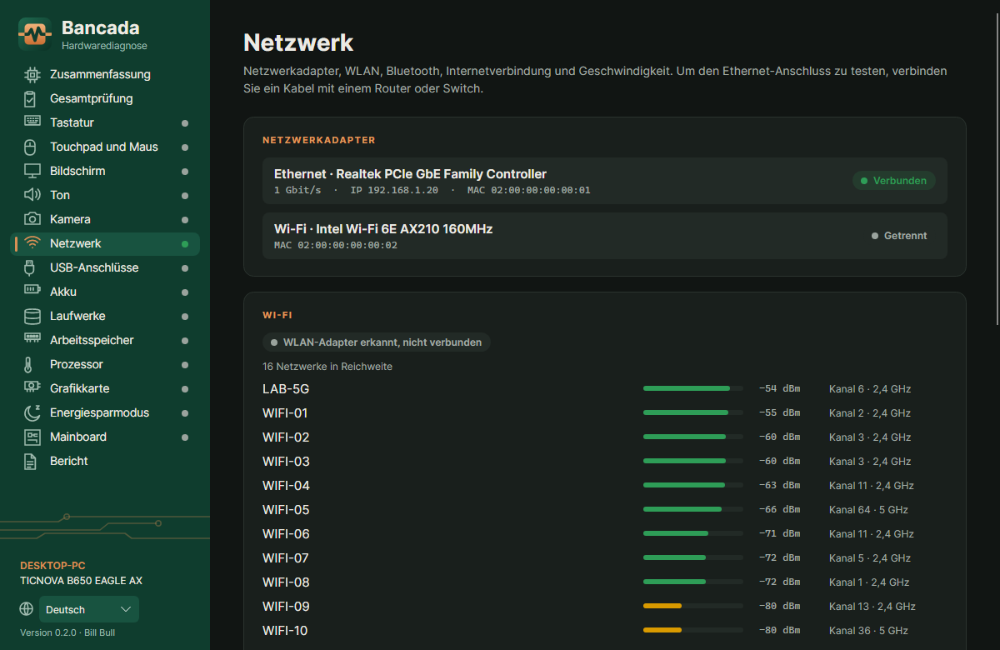
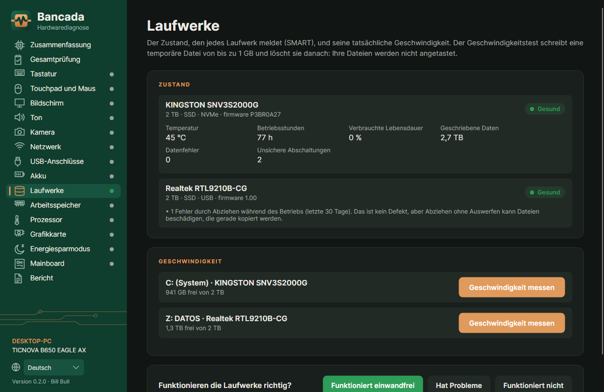
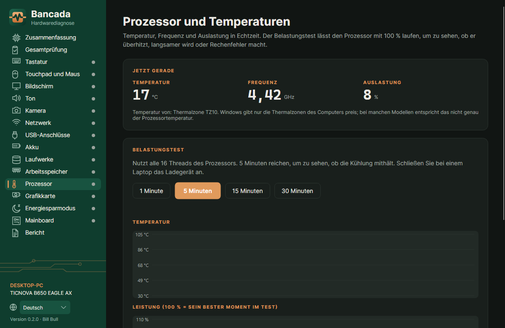
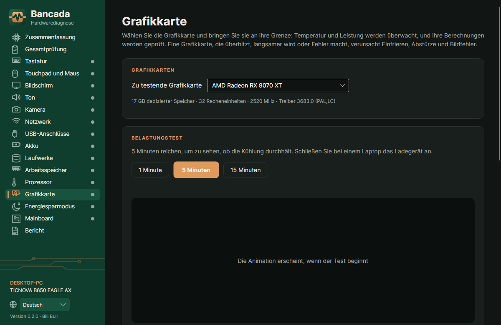
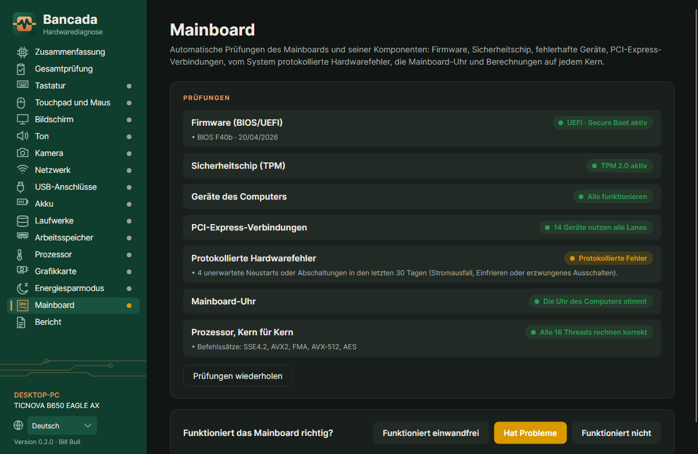
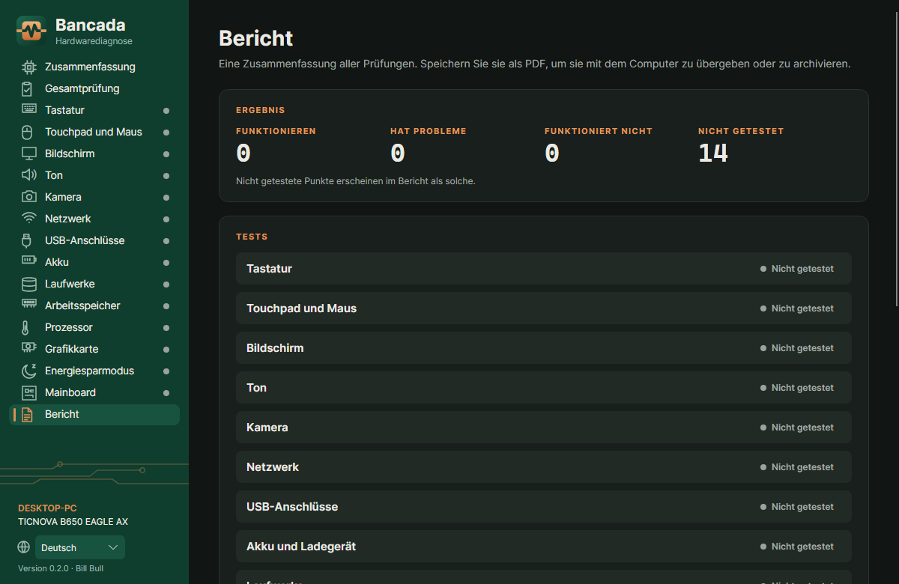

# Anleitung für Bancada

[English](en.md) · [Español](es.md) · [Português](pt.md) · [Français](fr.md) · **Deutsch** · [Italiano](it.md)

← [Zurück zum README](../../README.de.md)

## Bevor Sie beginnen

1. **Laden Sie** die ausführbare Datei für Ihr System von der [neuesten Version](https://github.com/bancada-hw/bancada/releases/latest) herunter.
   Sie können sie auf einem USB-Stick mitnehmen: Es wird nichts installiert, und außer den Einstellungen (Sprache und Tastatur) bleibt nichts zurück.
2. **Öffnen Sie sie** auf dem Computer, den Sie prüfen.
   - Windows: Doppelklick. Beim ersten Mal erscheint eventuell *„Der Computer wurde durch Windows geschützt“*: Klicken Sie auf *Weitere Informationen › Trotzdem ausführen*.
   - Linux: `chmod +x Bancada-linux-x64 && ./Bancada-linux-x64`.
3. **Bereithalten**: das Ladegerät (bei Laptops), einen USB-Stick oder eine USB-Maus für die Anschlüsse und, um die Kopfhörerbuchse zu testen, Kopfhörer.
4. **Rechte.** Fast alles funktioniert als normaler Benutzer. Als Administrator (Windows) oder mit `sudo` (Linux) sehen Sie zusätzlich die Seriennummer, die RAM-Module und die vollständigen SMART-Daten von SATA-Laufwerken.

Die Sprache wählen Sie unten in der Seitenleiste (Globus-Symbol); sie wird gespeichert.

## Das Hauptfenster

Links steht die Liste der Tests. Der farbige Punkt neben jedem Test zeigt sein Urteil:
**Funktioniert einwandfrei**, **Hat Probleme**, **Funktioniert nicht** oder nicht getestet.
Am Ende jedes Tests gibt es eine Leiste für das Urteil; automatische Tests schlagen eines vor, das Sie ändern können.

Die **Übersicht** zeigt, was im Computer steckt: Hersteller, Modell und Seriennummer, Typ (Laptop, Desktop-PC,
All-in-One, Mini-PC), Prozessor, RAM und belegte Steckplätze, Grafikkarten, Laufwerke mit Zustand, Akku,
Mainboard und BIOS.

## Gesamtprüfung (empfohlen)

Klicken Sie auf **Gesamtprüfung starten**. Bancada führt Sie Schritt für Schritt durch die Tests, bei denen Sie
etwas tun müssen: Tastatur → Ton → Touchpad → Bildschirm → Kamera → USB → Akku → Energiesparmodus.
Währenddessen laufen im Hintergrund nacheinander die automatischen Tests: Mainboard → Laufwerke → Netzwerk →
Speicher → Prozessor → jede Grafikkarte. Das Feld unten zeigt den Fortschritt.

- Die Belastungstests warten, bis Sie den Tontest abgeschlossen haben, damit das Lüftergeräusch nicht stört.
- Sie können einen Schritt überspringen; was nicht getestet wird, erscheint im Bericht als „Nicht getestet“.
- Der letzte Schritt versetzt den Computer für einige Sekunden in den Energiesparmodus: **Speichern Sie alles, was geöffnet ist**.
- Rechnen Sie mit etwa 20 Minuten. Klicken Sie am Ende auf **Abschließen und Bericht ansehen**.

## Die Tests im Einzelnen

### Tastatur

Drücken Sie jede Taste einmal: Ankommende Tasten werden grün; die leer bleiben, funktionieren nicht oder senden
kein Signal. Das Layout folgt der Sprache und der Systemtastatur; Sie können ein anderes aus der Liste wählen
(Spanisch, Lateinamerika, US, UK, Portugal, Brasilien ABNT2, Deutsch, Französisch und Italienisch).
Multimediatasten (Fn-Kombinationen) erscheinen unter „Weitere empfangene Tasten“.
Unter Windows leuchtet bei Alt Gr auch die linke Strg-Taste, und Druck kann das Snipping Tool öffnen: Das ist normal.

### Touchpad und Maus
Bewegen Sie den Zeiger über die Fläche, bis sie ausgefüllt ist. Stockt oder springt er irgendwo, ist dieser Teil
des Touchpads beschädigt: Fahren Sie auch Ränder und Ecken ab. Probieren Sie Links-, Rechts- und Mittelklick,
Doppelklick, Ziehen, das Mausrad oder Scrollen mit zwei Fingern, die Seitentasten, den Touchscreen und den Stift, falls vorhanden.

### Bildschirm
**Bildschirmtest starten** füllt den Bildschirm mit Vollfarben, Verläufen und einem Raster.
Klick, Leertaste oder → geht weiter; ← zurück; Esc beendet. Achten Sie auf tote oder hängende Pixel, Flecken,
Lichthöfe an den Rändern, Streifen in den Verläufen und ungleichmäßige Helligkeit.

### Ton
Jede Taste spielt nur auf einer Seite; beim Sweep von tief nach hoch hören Sie, ob etwas scheppert, brummt oder
knistert. **Mikrofon abhören** zeigt den Pegel live (sprechen oder klatschen Sie), und **5 Sekunden aufnehmen und
wiedergeben** lässt Sie hören, was aufgenommen wurde. Schließen Sie danach Kopfhörer an und wiederholen Sie den Test für die Buchse.

### Kamera
Schalten Sie jede Kamera ein und prüfen Sie, ob das Bild scharf ist, normale Farben hat und nicht aussetzt. Ist es
schwarz, prüfen Sie die Abdeckung oder die Taste, die die Kamera deaktiviert. Das Bild wird nie gespeichert und
verlässt nie den Computer.

### Netzwerk

Listet die physischen Adapter mit ihrer Verbindungsgeschwindigkeit, das WLAN mit Netzwerken in der Nähe (Signal,
Kanal und Band) und Bluetooth. Die Verbindung wird schrittweise geprüft (Router → DNS → Internet → sichere
Website), um zu sehen, wo sie abbricht. **Geschwindigkeit messen** misst 10 s Download und 10 s Upload mit den
Servern von Cloudflare. Um den Ethernet-Anschluss zu testen, verbinden Sie ein Kabel mit einem Router oder Switch.

### USB-Anschlüsse
Stecken Sie einen USB-Stick, eine Maus oder ein anderes Gerät nacheinander in jeden Anschluss: Jeder Anschluss,
der reagiert, wird mit seiner echten Geschwindigkeit markiert. Verbindet sich ein USB-3-Gerät mit USB-2-Tempo,
probieren Sie ein anderes Kabel; ändert sich nichts, ist vielleicht die Buchse beschädigt. Maus und Tastatur laufen
immer mit USB 1 oder 2.

### Akku und Ladegerät
Zeigt Nenn- und aktuelle Kapazität, Zustand, Zyklen und die Leistungsaufnahme live.
- **Ladegerättest:** Ziehen Sie das Ladegerät ab und stecken Sie es nach Anleitung wieder an; geprüft werden Ladegerät, Kabel und Ladebuchse.
- **Entladetest:** Bei abgezogenem Ladegerät misst er, wie lange der Akku wirklich hält. Sie wählen, was der
  Computer tut (Leerlauf mit eingeschaltetem Bildschirm, Surfen, Video oder Volllast), wann gestoppt wird (nach
  Zeit oder bei einem Prozentwert) und die Helligkeit. Er erkennt plötzliche Einbrüche des Prozentwerts (schlechte
  Zellen) und eine falsch kalibrierte Anzeige. Machen Sie mehrere mit verschiedenen Nutzungsarten: Der Bericht fasst
  sie in einer Laufzeittabelle zusammen.

### Laufwerke

SMART-Zustand jedes Laufwerks (Temperatur, Betriebsstunden, verbrauchte Lebensdauer, defekte Sektoren), vom System
protokollierte Lese- und Schreibfehler sowie die echte Lese-, Schreib- und 4-KB-Zufallsgeschwindigkeit. Der
Geschwindigkeitstest schreibt eine temporäre Datei von bis zu 1 GB und löscht sie danach: Ihre Dateien bleiben unberührt.

### Arbeitsspeicher
Füllt den freien Speicher mit 8 Mustern und prüft, ob genau das zurückgelesen wird, was geschrieben wurde. Ein
einziger Fehler bedeutet ein defektes Modul; testen Sie die Module einzeln, um herauszufinden, welches. Bei
laufendem System lässt sich nur der freie Speicher testen: Für den gesamten Speicher öffnet Bancada die
Windows-Speicherdiagnose oder erklärt, wie Sie MemTest86+ unter Linux starten.

### Prozessor

Temperatur, Frequenz und Auslastung live. Der Belastungstest nutzt alle Threads und überwacht, ob er zu heiß wird,
wegen der Hitze drosselt oder sich verrechnet. 5 Minuten reichen, um zu sehen, ob die Kühlung mithält; schließen
Sie bei einem Laptop das Ladegerät an.

### Grafikkarte

Wählen Sie die Grafikkarte nach ihrem Namen (dediziert, integriert oder eine andere) und bringen Sie sie an ihre
Grenze: Temperatur und Leistung werden überwacht und ihre Berechnungen geprüft. **Grafikspeicher prüfen** sucht
VRAM-Fehler, die Linien und farbige Punkte verursachen. Bancada nutzt OpenCL, das mit den Treibern von NVIDIA, AMD
und Intel kommt; unter Linux müssen Sie eventuell das OpenCL-Paket Ihrer Karte installieren.

### Energiesparmodus
Versetzt den Computer in den Energiesparmodus und prüft, ob er richtig zurückkommt: wie lange er schlief, ob das
Netzwerk wieder da ist und ob ein Gerät ausgefallen ist. Bei Computern mit modernem Standby wecken Sie ihn selbst
mit einer Taste, wie es der Kunde tun würde. Kommt er nicht zurück und muss hart ausgeschaltet werden, markiert
Bancada das beim nächsten Öffnen als Fehler.

### Mainboard

Automatische Prüfungen: Firmware und Secure Boot, TPM-Chip, fehlerhafte Geräte oder Geräte ohne Treiber,
PCI-Express-Verbindungen mit weniger Lanes als vorgesehen, protokollierte Hardwarefehler, die Mainboard-Uhr
(CMOS-Batterie) und korrekte Berechnung auf jedem Kern.

## Der Bericht

Fasst alle Tests mit Messwerten, Notizen und Urteilen zusammen. Fügen Sie eigene Notizen hinzu (äußerer Zustand,
Dellen, was der Kunde gesagt hat …) und klicken Sie auf **Bericht als PDF speichern**: Er wird im Ordner
„Dokumente“ gespeichert und enthält die Seriennummer des Computers.

## Häufige Probleme

| Was passiert | Was tun |
|---|---|
| Windows warnt, dass das Programm nicht sicher ist | Die Datei ist noch nicht signiert: *Weitere Informationen › Trotzdem ausführen*. |
| Keine Prozessortemperatur unter Windows | Manche Computer melden sie nur Programmen mit eigenem Treiber. Der Belastungstest erkennt Leistungsverlust und Fehler trotzdem. |
| „Kein OpenCL-Treiber installiert“ bei der Grafikkarte | Installieren oder aktualisieren Sie den Treiber von der Website von NVIDIA, AMD oder Intel. Unter Linux: `intel-opencl-icd`, `mesa-opencl-icd` oder ROCm. |
| Keine WLAN-Netzwerke unter Windows | Aktivieren Sie *Einstellungen › Datenschutz und Sicherheit › Standort › Desktop-Apps Zugriff auf Ihren Standort erlauben*. |
| Keine SMART-Daten unter Linux | Installieren Sie `smartmontools` und starten Sie Bancada mit `sudo`. |
| Startet unter Linux nicht und verlangt libICE oder libSM | Installieren Sie `libice6` und `libsm6` (die X11-Oberfläche braucht sie). |
