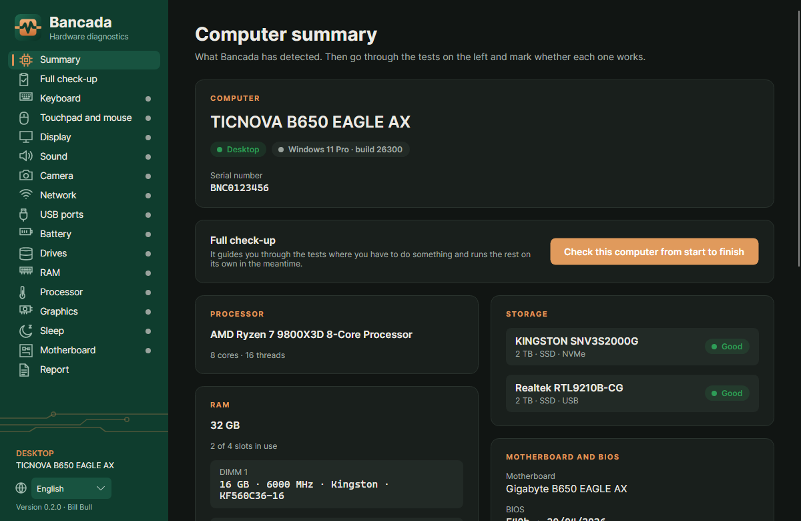
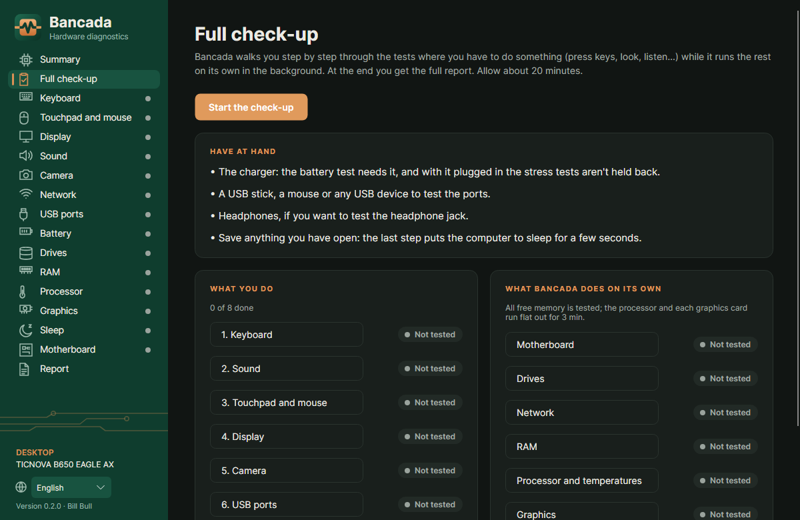
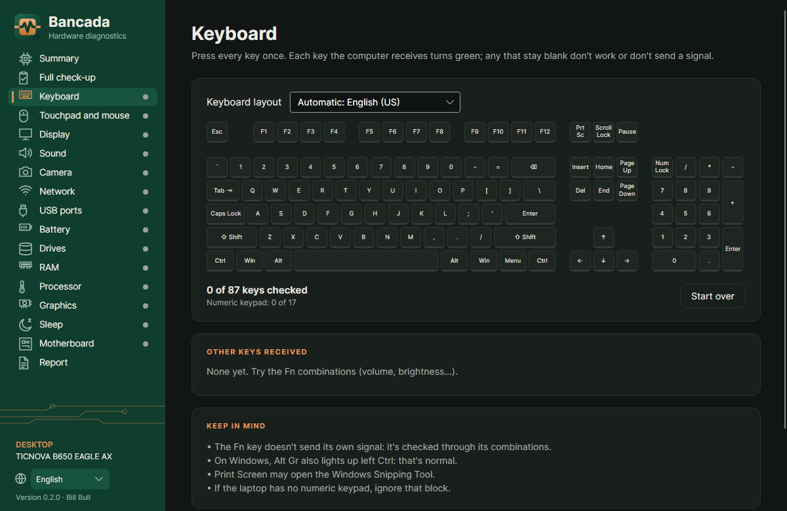
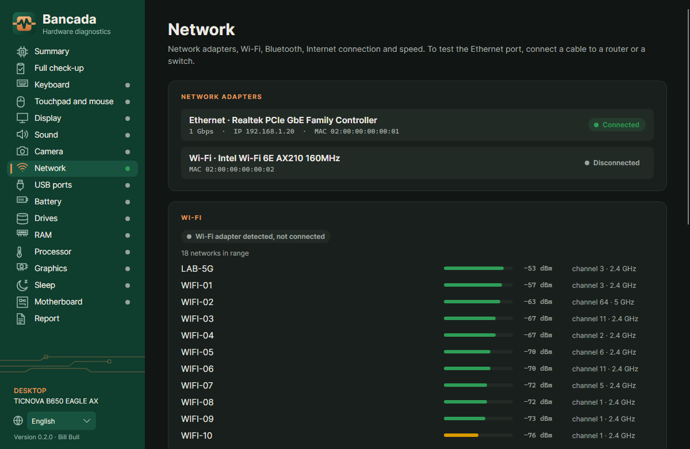
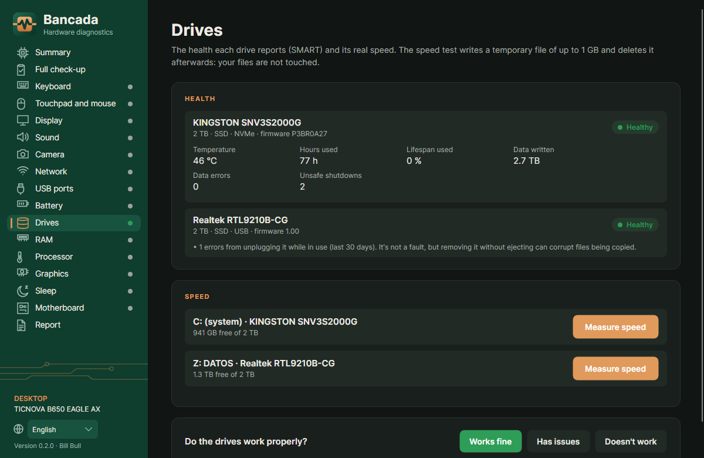
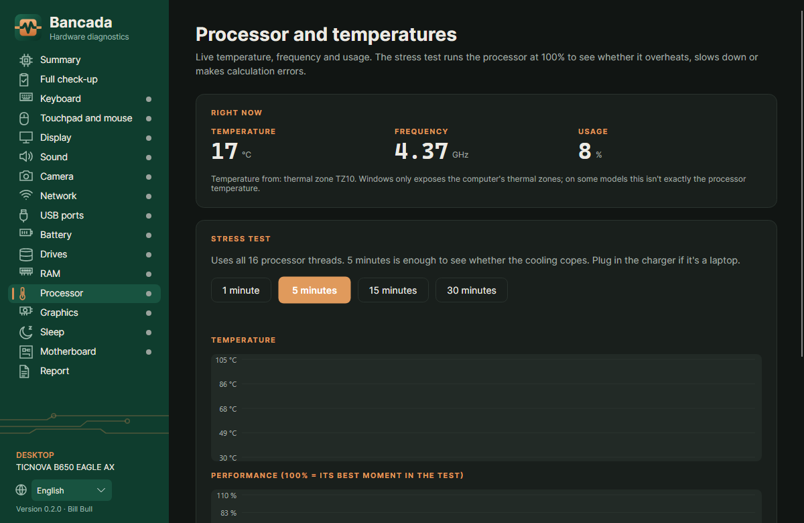
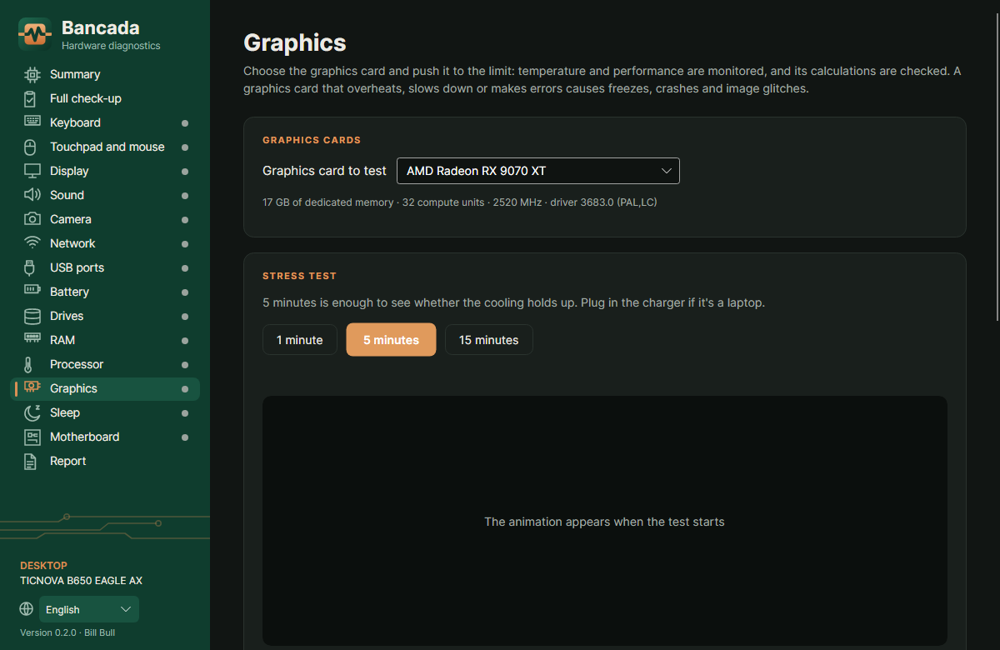
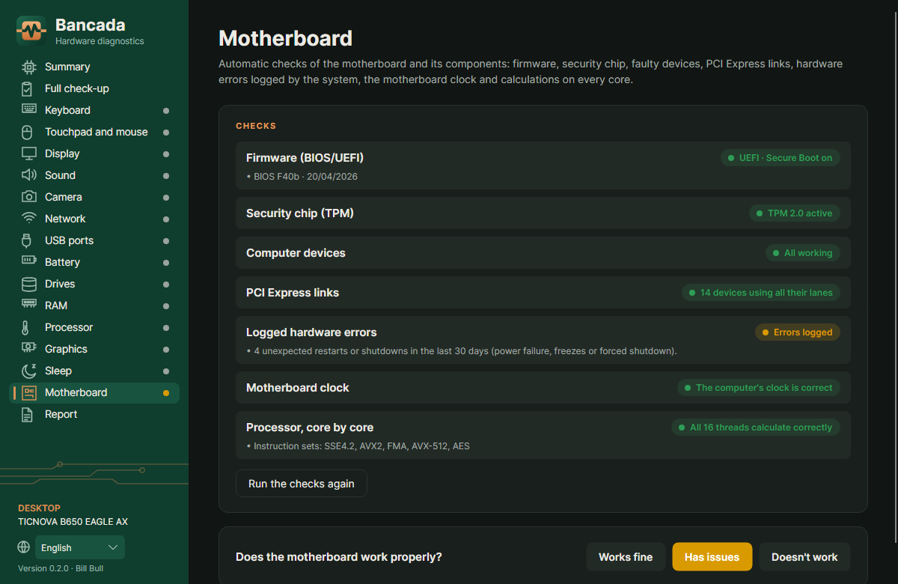
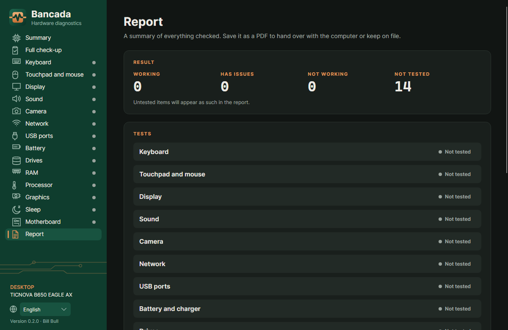

# Bancada user guide

**English** · [Español](es.md) · [Português](pt.md) · [Français](fr.md) · [Deutsch](de.md) · [Italiano](it.md)

← [Back to the README](../../README.md)

## Before you start

1. **Download** the executable for your system from the [latest release](https://github.com/bancada-hw/bancada/releases/latest).
   You can carry it on a USB stick: nothing is installed and it leaves nothing behind except its settings (language and keyboard).
2. **Open it** on the computer you're checking.
   - Windows: double-click. The first time you may see *"Windows protected your PC"*: click *More info › Run anyway*.
   - Linux: `chmod +x Bancada-linux-x64 && ./Bancada-linux-x64`.
3. **Have at hand**: the charger (for laptops), a USB stick or mouse for the ports and, to test the headphone jack, some headphones.
4. **Permissions.** Almost everything works as a normal user. As administrator (Windows) or with `sudo` (Linux) you also get the serial number, the RAM modules and full SMART data for SATA drives.

The language is chosen at the bottom of the sidebar (globe icon) and is remembered.

## The main window

The list of tests is on the left. The coloured dot next to each one shows its verdict:
**Works fine**, **Has issues**, **Doesn't work** or not tested.
At the end of each test there's a bar to set the verdict; automatic tests propose one and you can change it.

**Summary** shows what's in the computer: make, model and serial number, type (laptop, desktop,
all-in-one, mini PC), processor, RAM and slots in use, graphics, drives and their health, battery,
motherboard and BIOS.

## Full check-up (guided)

Click **Start the check-up**. Bancada walks you through the tests where you have to do something:
keyboard → sound → touchpad → display → camera → USB → battery → sleep.
Meanwhile, in the background and one after another, it runs the automatic ones: motherboard → drives →
network → memory → processor → each graphics card. The panel at the bottom shows how they're going.

- The stress tests wait until you finish the sound test, so the fan noise doesn't get in the way.
- You can skip a step; anything not tested shows as "Not tested" in the report.
- The last step puts the computer to sleep for a few seconds: **save anything you have open**.
- Allow about 20 minutes. When it's done, click **Finish and view the report**.

## Tests one by one

### Keyboard

Press every key once: keys that arrive turn green; any that stay blank don't work or don't send a signal.
The layout follows the interface language and the system keyboard; you can pick another from the list
(Spanish, Latin American, US, UK, Portugal, Brazil ABNT2, German, French and Italian).
Media keys (Fn combinations) show up under "Other keys received".
On Windows, Alt Gr also lights up left Ctrl and Print Screen may open the Snipping Tool: that's normal.

### Touchpad and mouse
Move the pointer over the area until it's filled. If the pointer stops or jumps somewhere, that part of the
touchpad is damaged: cover the edges and corners too. Try left, right and middle click, double click,
dragging, the wheel or two-finger scrolling, the side buttons, the touchscreen and the pen if there are any.

### Display
**Start display test** fills the screen with solid colours, gradients and a grid.
Click, Space or → goes to the next one; ← goes back; Esc exits. Look for dead or stuck pixels, blotches,
backlight bleed at the edges, banding in the gradients and uneven brightness.

### Sound
Each button plays on one side only; the low-to-high sweep lets you hear rattling, buzzing or crackling.
**Listen to the microphone** shows the live level (speak or clap) and **Record 5 seconds and play back**
lets you hear what it picked up. Then plug in headphones and repeat to test the jack.

### Camera
Turn on each camera and check that the picture is sharp, with normal colours and no dropouts. If it's black,
check the privacy shutter or the key that disables it. The picture is never saved and never leaves the computer.

### Network

Lists the physical adapters with their link speed, Wi-Fi with nearby networks (signal, channel and band)
and Bluetooth. The connection is checked step by step (router → DNS → Internet → secure website) to see where
it breaks. **Measure speed** runs 10 s of download and 10 s of upload against Cloudflare's servers.
To test the Ethernet port, connect a cable to a router or a switch.

### USB ports
Plug a USB stick, a mouse or any device into each port, one at a time: every port that responds is marked
with its real speed. If a USB 3 device connects at USB 2 speed, try another cable; if nothing changes, the
port's connector may be damaged. A mouse or keyboard always runs at USB 1 or 2 speed.

### Battery and charger
Shows design and current capacity, health, cycles and live power draw.
- **Charger test:** unplug and plug back in following the steps; it checks the charger, the cable and the power connector.
- **Discharge test:** with the charger unplugged, it measures how long the battery really lasts. You choose
  what the computer does (idle with the screen on, browsing, watching video or full load), when to stop (after
  a time or at a percentage) and the brightness. It detects sudden drops in the percentage (bad cells) and a
  miscalibrated gauge. Run several with different kinds of use and the report puts them together in a battery-life table.

### Drives

SMART health for each drive (temperature, hours, lifespan used, bad sectors), read and write errors logged by
the system, and real read, write and random 4 KB speed. The speed test writes a temporary file of up to 1 GB
and deletes it afterwards: your files are not touched.

### RAM
Fills free memory with 8 patterns and checks that it reads back exactly what was written. A single error means
a module is bad; test the modules one at a time to find out which. While the system is running only free
memory can be tested: to test all of it, Bancada opens Windows Memory Diagnostic or tells you how to start
MemTest86+ on Linux.

### Processor

Live temperature, frequency and usage. The stress test uses every thread and watches whether it gets too hot,
slows down because of heat or gets any calculation wrong. 5 minutes is enough to see whether the cooling copes;
plug in the charger if it's a laptop.

### Graphics

Pick the graphics card by name (dedicated, integrated or any other) and push it to the limit: temperature and
performance are monitored and its calculations are checked. **Check the video memory** looks for VRAM faults,
the kind that cause lines and coloured dots. It uses OpenCL, which comes with the NVIDIA, AMD and Intel drivers;
on Linux you may need to install your card's OpenCL package.

### Sleep
Puts the computer to sleep and checks that it comes back properly: how long it slept, whether the network
recovers and whether any device stopped working. On computers with modern standby, wake it yourself with a key
as the customer would. If it doesn't come back and has to be forced off, Bancada marks it as a failure the next time it opens.

### Motherboard

Automatic checks: firmware and Secure Boot, TPM chip, faulty devices or devices without a driver, PCI Express
links with fewer lanes than they should have, logged hardware errors, the motherboard clock (CMOS battery) and
correct calculation on every core.

## The report

Brings every test together with its measurements, notes and verdicts. Add your own notes (physical condition,
dents, what the customer said…) and click **Save report as PDF**: it's saved to your Documents folder and
includes the computer's serial number.

## Common problems

| What happens | What to do |
|---|---|
| Windows warns that the program isn't safe | The executable isn't signed yet: *More info › Run anyway*. |
| No processor temperature on Windows | Some computers only report it to programs with their own driver. The stress test still detects performance loss and errors. |
| "No OpenCL driver is installed" in Graphics | Install or update the driver from the NVIDIA, AMD or Intel website. On Linux: `intel-opencl-icd`, `mesa-opencl-icd` or ROCm. |
| No Wi-Fi networks on Windows | Turn on *Settings › Privacy & security › Location › Let desktop apps access your location*. |
| No SMART data on Linux | Install `smartmontools` and run Bancada with `sudo`. |
| It won't start on Linux and asks for libICE or libSM | Install `libice6` and `libsm6` (the X11 interface needs them). |
