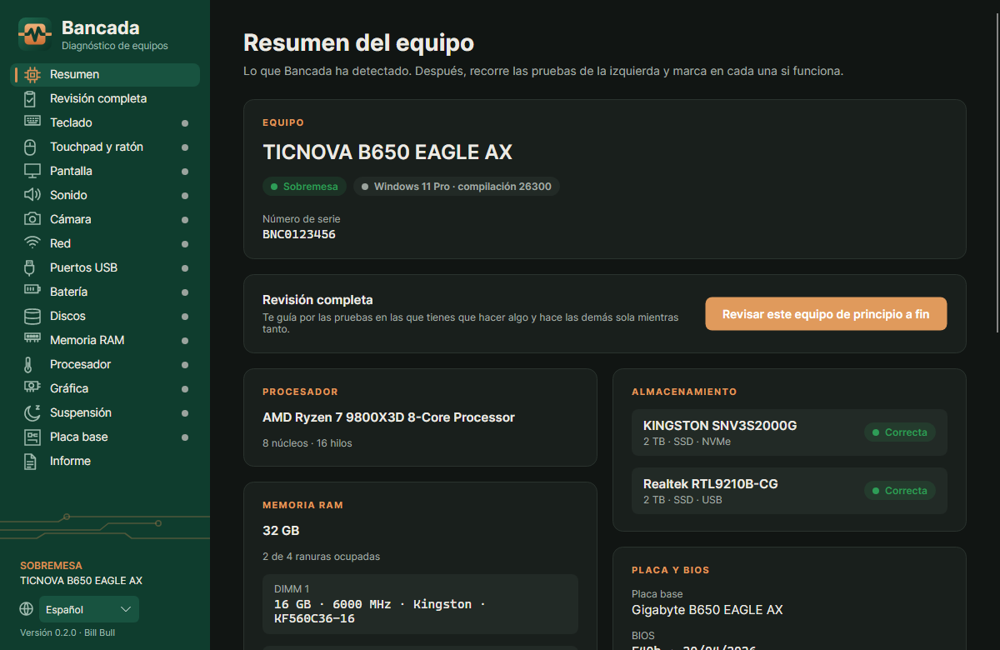
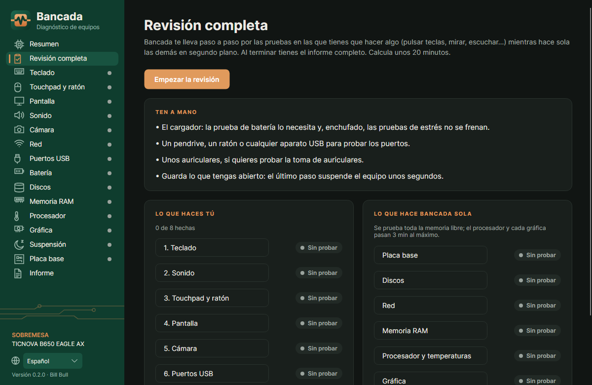
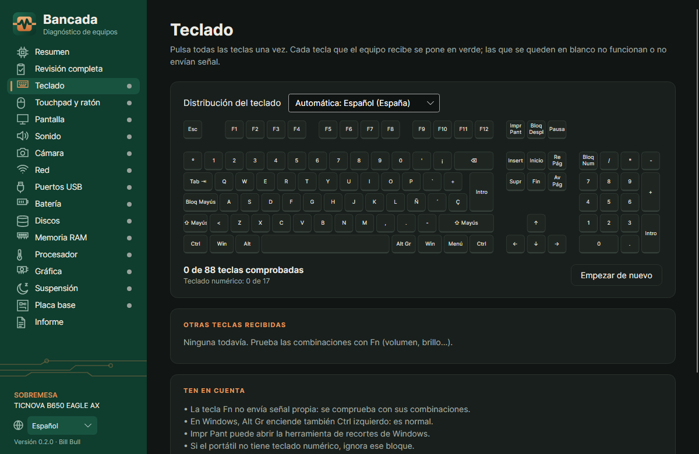
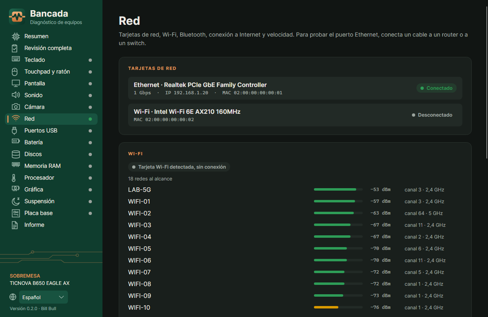
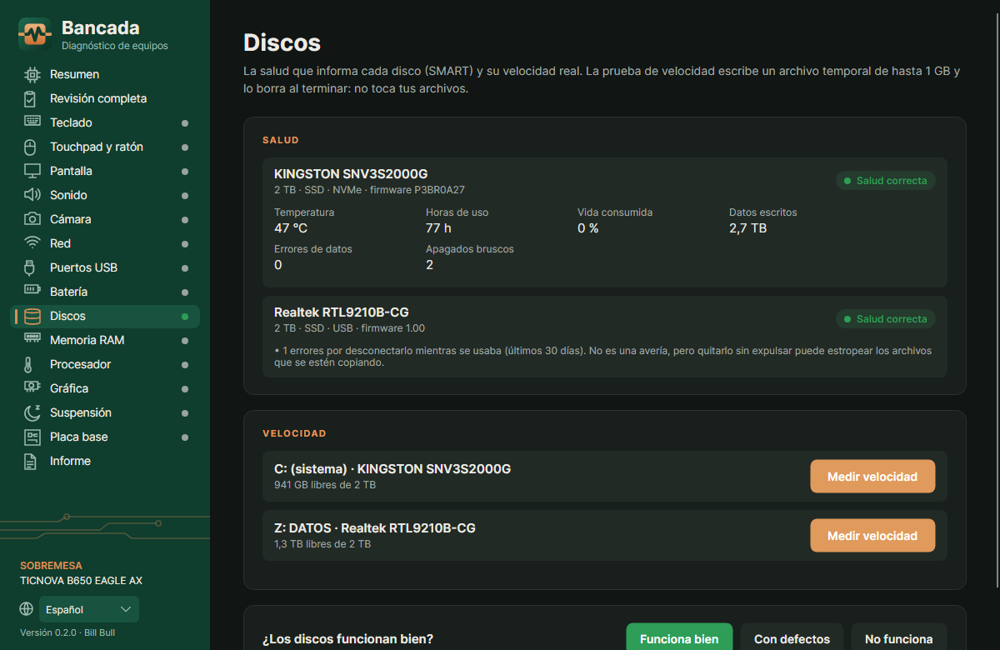
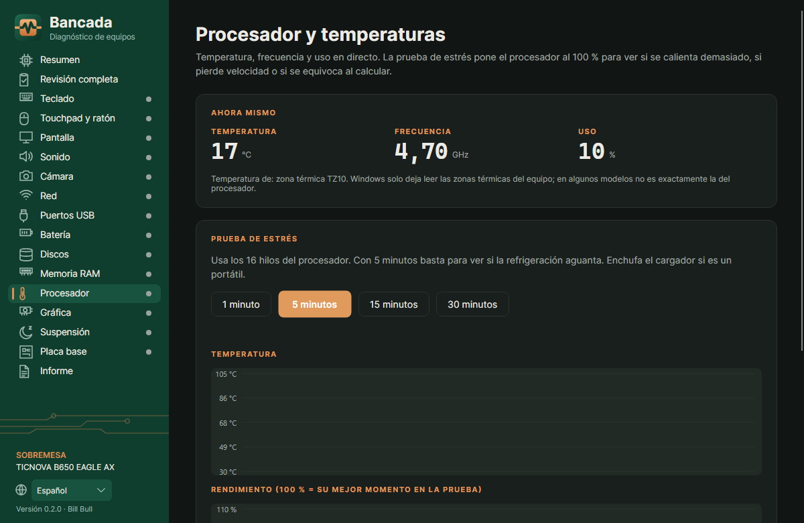
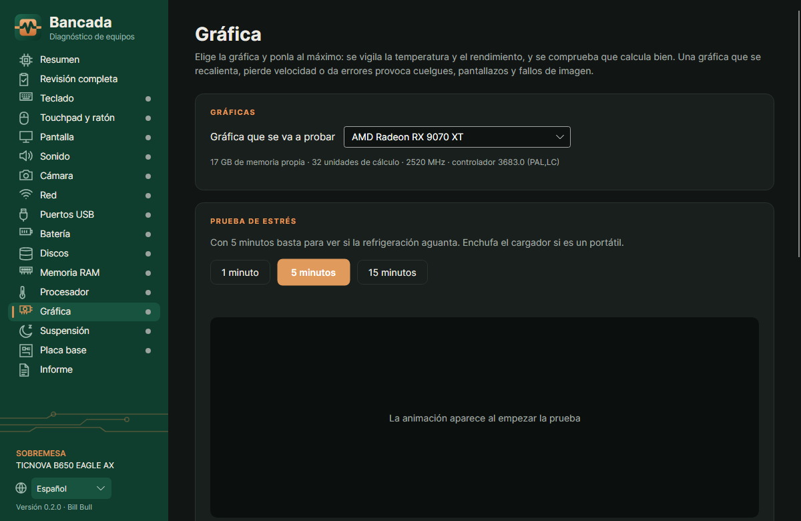
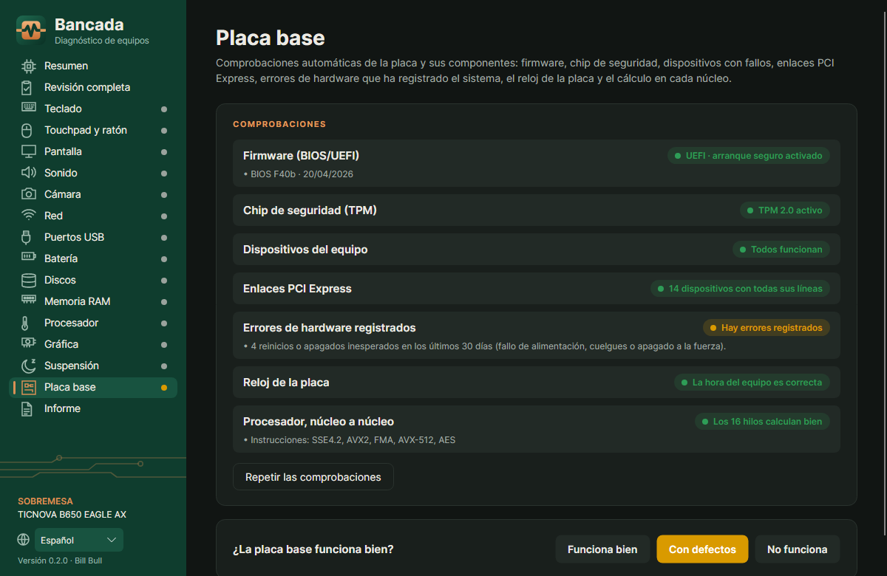
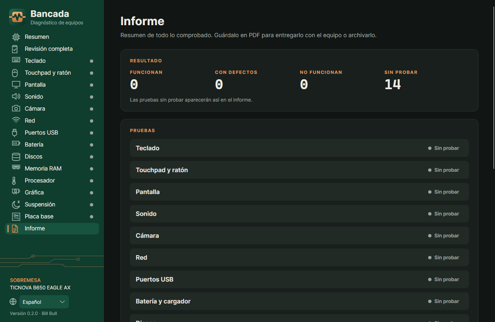

# Guía de uso de Bancada

[English](en.md) · **Español** · [Português](pt.md) · [Français](fr.md) · [Deutsch](de.md) · [Italiano](it.md)

← [Volver al README](../../README.es.md)

## Antes de empezar

1. **Descarga** el ejecutable de tu sistema desde la [última versión](https://github.com/bancada-hw/bancada/releases/latest).
   Puedes llevarlo en un pendrive: no se instala y no deja nada en el equipo salvo sus ajustes (idioma y teclado).
2. **Ábrelo** en el equipo que vas a revisar.
   - Windows: doble clic. La primera vez puede salir *«Windows protegió su PC»*: pulsa *Más información › Ejecutar de todas formas*.
   - Linux: `chmod +x Bancada-linux-x64 && ./Bancada-linux-x64`.
3. **Ten a mano**: el cargador (si es portátil), un pendrive o un ratón USB para los puertos y, si quieres probar la toma de auriculares, unos auriculares.
4. **Permisos.** Casi todo funciona como usuario normal. Como administrador (Windows) o con `sudo` (Linux) se ven además el número de serie, los módulos de RAM y el SMART completo de los discos SATA.

El idioma se elige en la parte de abajo de la barra lateral (icono del globo) y se recuerda.

## La pantalla principal

A la izquierda está la lista de pruebas. El punto de color junto a cada una indica su veredicto:
**Funciona bien**, **Con defectos**, **No funciona** o sin probar.
Al final de cada prueba hay una barra para marcar el veredicto; en las automáticas viene propuesto y puedes cambiarlo.

**Resumen** muestra lo que lleva el equipo: marca, modelo y número de serie, tipo (portátil, sobremesa,
todo en uno, mini PC), procesador, RAM y ranuras ocupadas, gráficas, discos con su salud, batería, placa y BIOS.

## Revisión completa (guiada)

Pulsa **Empezar la revisión**. Bancada te lleva paso a paso por las pruebas en las que tienes que hacer
algo: teclado → sonido → touchpad → pantalla → cámara → USB → batería → suspensión.
Mientras tanto, en segundo plano y una detrás de otra, hace las automáticas: placa → discos → red →
memoria → procesador → cada gráfica. El panel de abajo enseña cuál va por dónde.

- Las pruebas de estrés esperan a que termines la de sonido, para que el ruido del ventilador no moleste.
- Puedes saltarte un paso; lo que no se pruebe saldrá como «Sin probar» en el informe.
- El último paso suspende el equipo unos segundos: **guarda lo que tengas abierto**.
- Calcula unos 20 minutos. Al acabar, **Terminar y ver el informe**.

## Pruebas una a una

### Teclado

Pulsa cada tecla una vez: las que llegan se ponen en verde; las que se quedan sin color no funcionan o no
envían señal. La distribución sigue al idioma y al teclado del sistema; puedes elegir otra en el desplegable
(española, latinoamericana, EE. UU., Reino Unido, Portugal, Brasil ABNT2, alemana, francesa e italiana).
Las teclas multimedia (combinaciones con Fn) aparecen en «Otras teclas recibidas».
En Windows, Alt Gr enciende también Ctrl izquierdo, y Impr Pant puede abrir la herramienta de recortes: es normal.

### Touchpad y ratón
Mueve el puntero por la zona hasta llenarla. Si en algún sitio se para o salta, esa parte del touchpad está
dañada: repasa también bordes y esquinas. Prueba clic izquierdo, derecho y central, doble clic, arrastrar,
la rueda o el desplazamiento con dos dedos, los botones laterales, la pantalla táctil y el lápiz si los hay.

### Pantalla
**Empezar prueba de pantalla** llena la pantalla de colores lisos, degradados y cuadrícula.
Clic, espacio o → pasa al siguiente; ← vuelve; Esc sale. Busca píxeles muertos o fijos, manchas,
fugas de luz en los bordes, bandas en los degradados y brillo desigual.

### Sonido
Cada botón suena por un solo lado; el barrido de graves a agudos sirve para oír si algo vibra, zumba o cruje.
**Escuchar el micrófono** enseña el nivel en directo (habla o da una palmada) y **Grabar 5 segundos y reproducir** te deja
oír lo que capta. Después conecta auriculares y repite para probar la toma.

### Cámara
Enciende cada cámara y mira que la imagen sea nítida, con colores normales y sin cortes. Si sale negra,
revisa la tapa de privacidad o la tecla que la desactiva. La imagen nunca se guarda ni sale del equipo.

### Red

Lista las tarjetas físicas con su velocidad de enlace, la Wi-Fi con las redes cercanas (señal, canal y banda)
y el Bluetooth. La conexión se comprueba por pasos (router → DNS → Internet → web segura) para ver dónde se
corta. **Medir velocidad** hace 10 s de bajada y 10 de subida contra los servidores de Cloudflare.
Para probar el puerto Ethernet, conecta un cable a un router o un switch.

### Puertos USB
Conecta un pendrive, un ratón o cualquier aparato en cada puerto, de uno en uno: cada puerto que responde
queda marcado con su velocidad real. Si un aparato USB 3 conecta a velocidad USB 2, prueba otro cable; si
no cambia, el conector del puerto puede estar dañado. Un ratón o un teclado siempre van a USB 1 o 2.

### Batería y cargador
Muestra la capacidad de fábrica y la actual, la salud, los ciclos y el consumo en directo.
- **Prueba del cargador:** desenchufa y vuelve a enchufar siguiendo los pasos; comprueba cargador, cable y conector.
- **Prueba de descarga:** con el cargador quitado, mide cuánto dura de verdad. Eliges qué hace el equipo
  (en reposo con la pantalla encendida, navegando, viendo vídeo o a carga máxima), cuándo parar (por tiempo
  o al llegar a un porcentaje) y el brillo. Detecta caídas bruscas del porcentaje (celdas en mal estado) y un
  indicador descalibrado. Haz varias con distintos usos y el informe las junta en una tabla de autonomía.

### Discos

Salud SMART de cada disco (temperatura, horas, vida consumida, sectores dañados), errores de lectura y
escritura que ha registrado el sistema, y velocidad real de lectura, escritura y lectura aleatoria de 4 KB.
La prueba de velocidad escribe un archivo temporal de hasta 1 GB y lo borra al acabar: tus archivos no se tocan.

### Memoria RAM
Llena la memoria libre con 8 patrones y comprueba que se lee exactamente lo escrito. Un solo error significa
que un módulo está mal; prueba los módulos de uno en uno para saber cuál. Con el sistema en marcha solo se
puede probar la memoria libre: para probarla entera, Bancada abre el diagnóstico de memoria de Windows o
te indica cómo arrancar MemTest86+ en Linux.

### Procesador

Temperatura, frecuencia y uso en directo. La prueba de estrés usa todos los hilos y vigila si se calienta
demasiado, si baja el rendimiento por temperatura y si algún cálculo sale mal. Con 5 minutos basta para ver
si la refrigeración aguanta; si es portátil, conecta el cargador.

### Gráfica

Elige la gráfica por su nombre (dedicada, integrada o cualquier otra) y ponla al máximo: se vigilan
temperatura y rendimiento y se comprueban sus cálculos. **Comprobar la memoria de vídeo** busca fallos de
VRAM, los que causan rayas y puntos de colores. Usa OpenCL, que viene con los controladores de NVIDIA, AMD e
Intel; en Linux puede hacer falta instalar el paquete OpenCL de tu gráfica.

### Suspensión
Suspende el equipo y comprueba que vuelve bien: cuánto estuvo dormido, si la red se recupera y si algún
dispositivo deja de funcionar. En equipos con suspensión moderna, despiértalo tú con una tecla como haría el
cliente. Si no vuelve y hay que forzar el apagado, al abrir Bancada otra vez lo marca como fallo.

### Placa base

Comprobaciones automáticas: firmware y arranque seguro, chip TPM, dispositivos con fallos o sin
controlador, enlaces PCI Express con menos líneas de las debidas, errores de hardware registrados, reloj de
la placa (pila CMOS) y cálculo correcto núcleo a núcleo.

## El informe

Junta todas las pruebas con sus medidas, observaciones y veredictos. Añade tus notas (estado físico,
golpes, lo que contó el cliente…) y pulsa **Guardar informe en PDF**: se guarda en Documentos y lleva el
número de serie del equipo.

## Problemas frecuentes

| Qué pasa | Qué hacer |
|---|---|
| Windows avisa de que el programa no es seguro | Es porque el ejecutable aún no está firmado: *Más información › Ejecutar de todas formas*. |
| No aparece la temperatura del procesador en Windows | Algunos equipos solo la dan a programas con controlador propio. La prueba de estrés sigue detectando pérdidas de rendimiento y errores. |
| «No hay ningún controlador OpenCL» en la gráfica | Instala o actualiza el controlador desde la web de NVIDIA, AMD o Intel. En Linux: `intel-opencl-icd`, `mesa-opencl-icd` o ROCm. |
| No salen las redes Wi-Fi en Windows | Activa *Configuración › Privacidad y seguridad › Ubicación › Permitir que las aplicaciones de escritorio accedan a la ubicación*. |
| En Linux no se ven los datos SMART | Instala `smartmontools` y abre Bancada con `sudo`. |
| En Linux no arranca y pide libICE o libSM | Instala `libice6` y `libsm6` (los necesita la interfaz en X11). |
