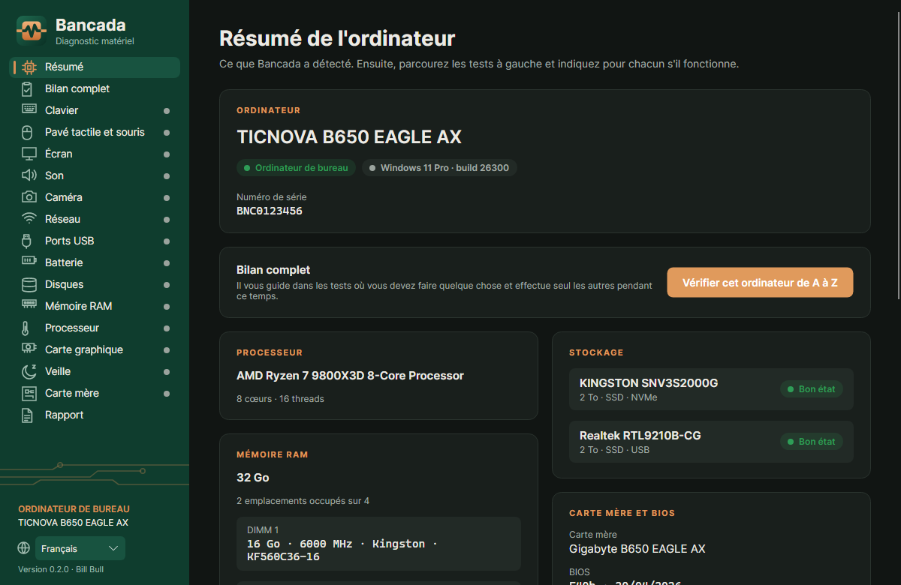
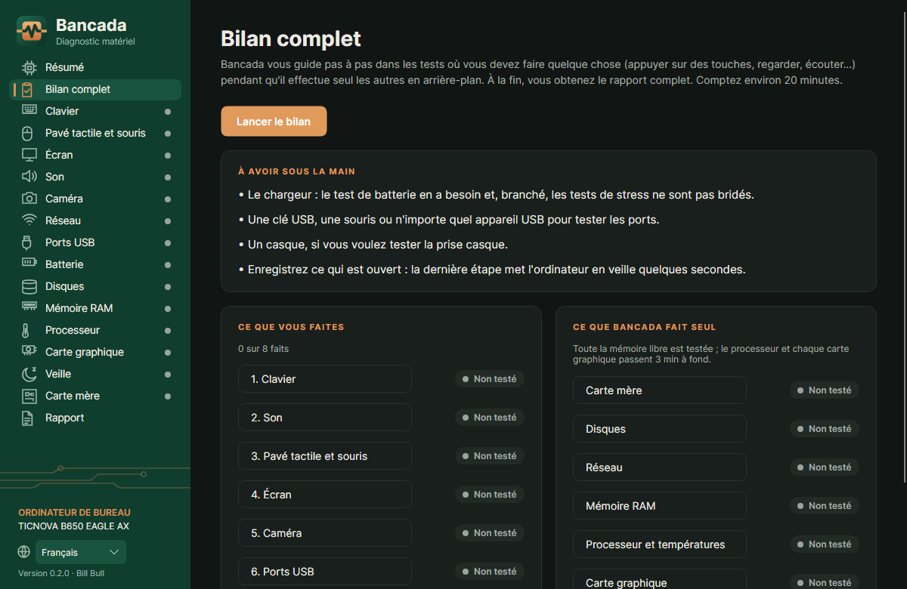
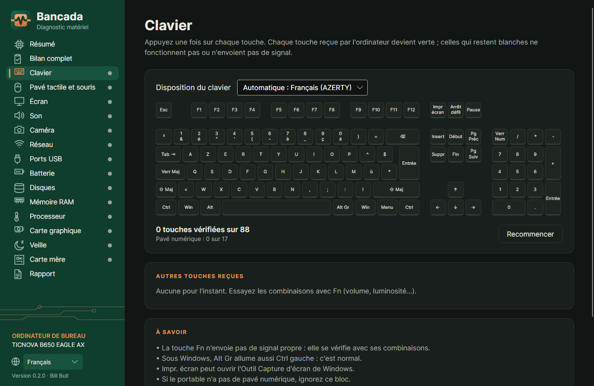
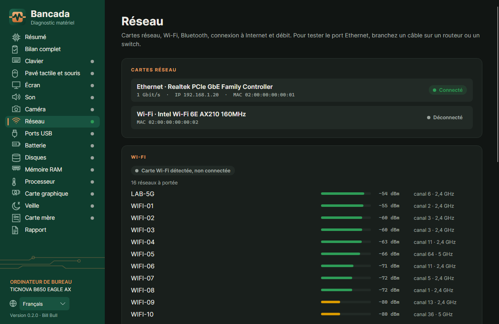
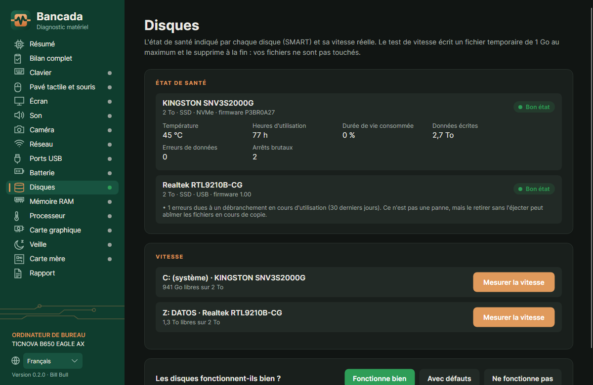
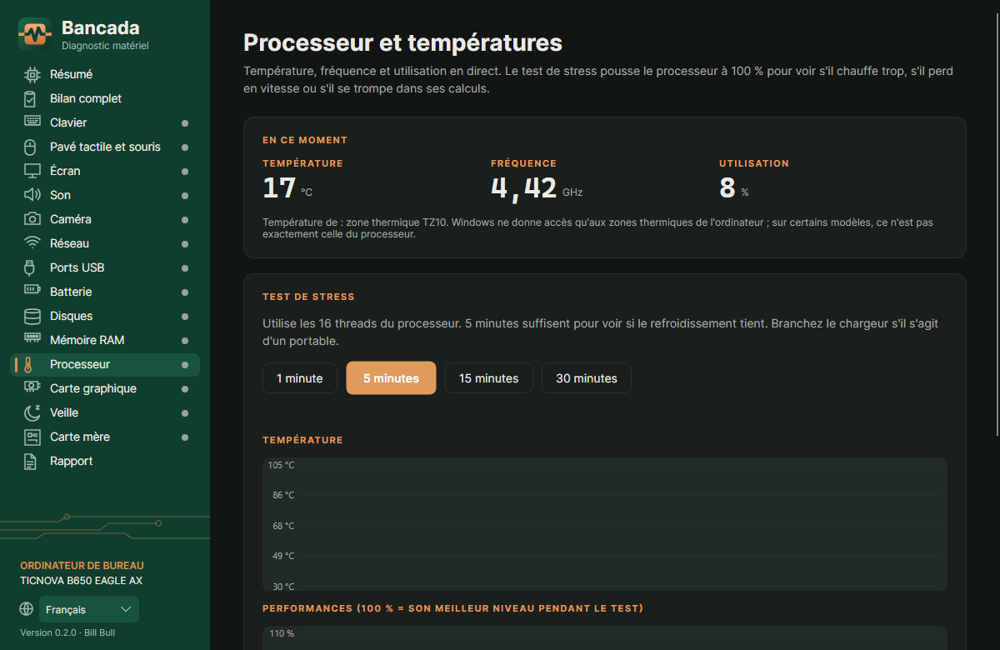
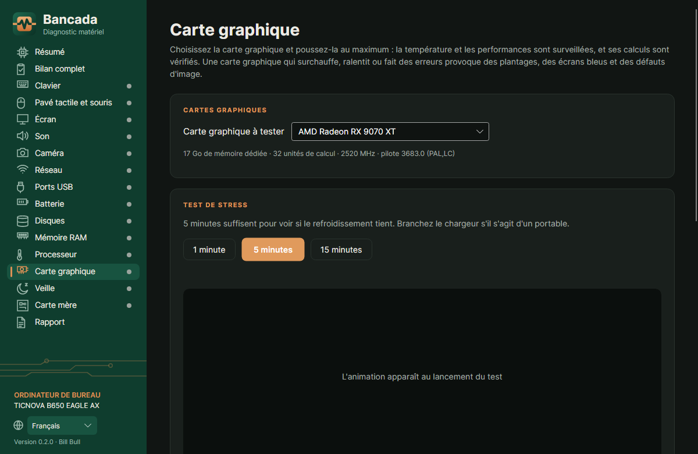
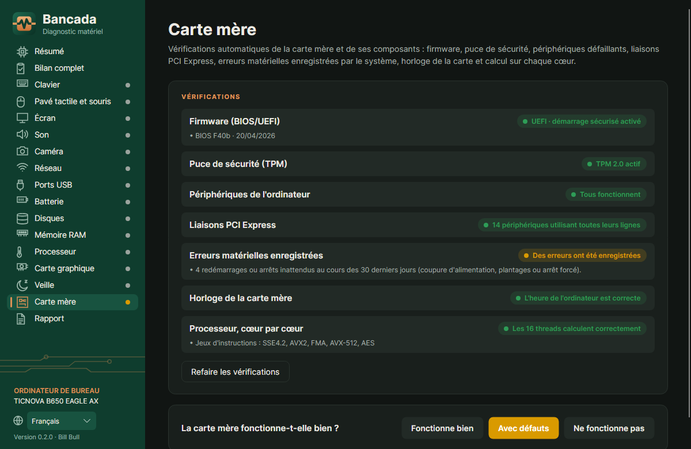
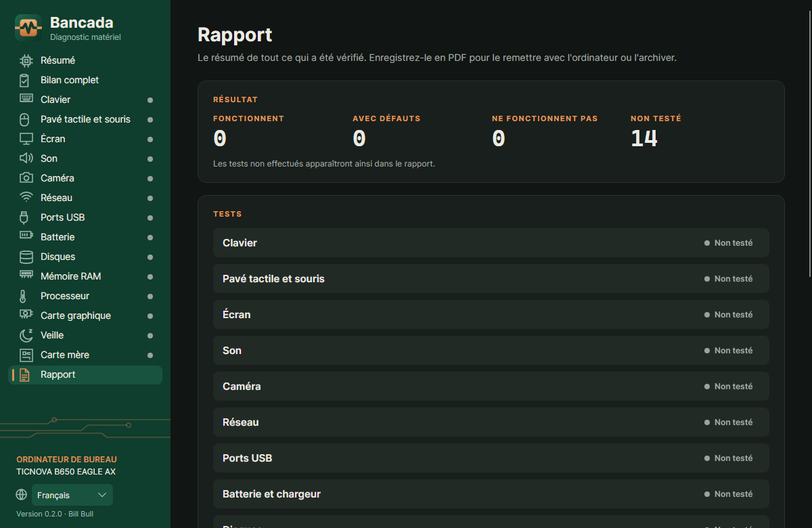

# Guide d'utilisation de Bancada

[English](en.md) · [Español](es.md) · [Português](pt.md) · **Français** · [Deutsch](de.md) · [Italiano](it.md)

← [Retour au README](../../README.fr.md)

## Avant de commencer

1. **Téléchargez** l'exécutable de votre système depuis la [dernière version](https://github.com/bancada-hw/bancada/releases/latest).
   Vous pouvez l'emporter sur une clé USB : rien ne s'installe et il ne laisse rien sur l'ordinateur à part ses réglages (langue et clavier).
2. **Ouvrez-le** sur l'ordinateur à contrôler.
   - Windows : double-clic. La première fois, *« Windows a protégé votre ordinateur »* peut s'afficher : cliquez sur *Informations complémentaires › Exécuter quand même*.
   - Linux : `chmod +x Bancada-linux-x64 && ./Bancada-linux-x64`.
3. **Ayez sous la main** : le chargeur (pour un portable), une clé ou une souris USB pour les ports et, pour tester la prise casque, un casque.
4. **Droits.** Presque tout fonctionne en utilisateur normal. En administrateur (Windows) ou avec `sudo` (Linux), vous voyez aussi le numéro de série, les barrettes de RAM et le SMART complet des disques SATA.

La langue se choisit en bas de la barre latérale (icône du globe) et est mémorisée.

## La fenêtre principale

La liste des tests est à gauche. Le point de couleur à côté de chacun indique son verdict :
**Fonctionne bien**, **Avec défauts**, **Ne fonctionne pas** ou non testé.
À la fin de chaque test, une barre permet de choisir le verdict ; les tests automatiques le proposent et vous pouvez le changer.

Le **Résumé** montre ce que contient l'ordinateur : marque, modèle et numéro de série, type (portable, fixe,
tout-en-un, mini PC), processeur, RAM et emplacements occupés, cartes graphiques, disques et leur santé,
batterie, carte mère et BIOS.

## Bilan complet (recommandé)

Cliquez sur **Lancer le bilan**. Bancada vous guide pas à pas dans les tests où vous devez agir :
clavier → son → pavé tactile → écran → caméra → USB → batterie → veille.
Pendant ce temps, en arrière-plan et l'un après l'autre, il fait les tests automatiques : carte mère → disques →
réseau → mémoire → processeur → chaque carte graphique. Le panneau du bas montre leur avancement.

- Les tests de stress attendent la fin du test du son, pour que le bruit du ventilateur ne gêne pas.
- Vous pouvez sauter une étape ; ce qui n'est pas testé apparaît comme « Non testé » dans le rapport.
- La dernière étape met l'ordinateur en veille quelques secondes : **enregistrez ce qui est ouvert**.
- Comptez environ 20 minutes. À la fin, cliquez sur **Terminer et voir le rapport**.

## Les tests un par un

### Clavier

Appuyez une fois sur chaque touche : celles qui arrivent passent au vert ; celles qui restent sans couleur ne
fonctionnent pas ou n'envoient pas de signal. La disposition suit la langue et le clavier du système ; vous
pouvez en choisir une autre dans la liste (espagnol, latino-américain, US, Royaume-Uni, Portugal, Brésil ABNT2,
allemand, français et italien). Les touches multimédia (combinaisons avec Fn) apparaissent dans « Autres touches
reçues ». Sous Windows, Alt Gr allume aussi Ctrl gauche et Impr. écran peut ouvrir l'Outil Capture d'écran : c'est normal.

### Pavé tactile et souris
Déplacez le pointeur sur la zone jusqu'à la remplir. S'il s'arrête ou saute quelque part, cette partie du pavé
est abîmée : passez aussi sur les bords et les coins. Essayez les clics gauche, droit et central, le double-clic,
le glisser, la molette ou le défilement à deux doigts, les boutons latéraux, l'écran tactile et le stylet s'il y en a.

### Écran
**Lancer le test d'écran** remplit l'écran de couleurs unies, de dégradés et d'une grille.
Clic, Espace ou → passe au suivant ; ← revient ; Échap quitte. Cherchez les pixels morts ou bloqués, les taches,
les fuites de lumière sur les bords, les bandes dans les dégradés et une luminosité inégale.

### Son
Chaque bouton joue d'un seul côté ; le balayage des graves aux aigus permet d'entendre si quelque chose vibre,
bourdonne ou grésille. **Écouter le micro** affiche le niveau en direct (parlez ou tapez dans les mains) et
**Enregistrer 5 secondes et réécouter** vous fait entendre ce qu'il a capté. Branchez ensuite un casque et
recommencez pour tester la prise.

### Caméra
Allumez chaque caméra et vérifiez que l'image est nette, aux couleurs normales et sans coupures. Si elle est
noire, vérifiez le cache de confidentialité ou la touche qui la désactive. L'image n'est jamais enregistrée et ne
quitte jamais l'ordinateur.

### Réseau

Liste les cartes physiques avec leur vitesse de liaison, le Wi-Fi avec les réseaux proches (signal, canal et
bande) et le Bluetooth. La connexion est vérifiée étape par étape (routeur → DNS → Internet → site sécurisé) pour
voir où elle coupe. **Mesurer la vitesse** fait 10 s de téléchargement et 10 s d'envoi avec les serveurs de
Cloudflare. Pour tester le port Ethernet, branchez un câble sur un routeur ou un switch.

### Ports USB
Branchez une clé, une souris ou n'importe quel appareil sur chaque port, un par un : chaque port qui répond est
marqué avec sa vitesse réelle. Si un appareil USB 3 se connecte en USB 2, essayez un autre câble ; si rien ne
change, le connecteur du port est peut-être abîmé. Une souris ou un clavier fonctionnent toujours en USB 1 ou 2.

### Batterie et chargeur
Affiche la capacité d'origine et actuelle, la santé, les cycles et la consommation en direct.
- **Test du chargeur :** débranchez et rebranchez en suivant les étapes ; il vérifie le chargeur, le câble et le connecteur.
- **Test de décharge :** chargeur débranché, il mesure combien de temps la batterie tient vraiment. Vous choisissez
  ce que fait l'ordinateur (au repos écran allumé, navigation, vidéo ou pleine charge), quand arrêter (au bout d'un
  temps ou à un pourcentage) et la luminosité. Il détecte les chutes brutales du pourcentage (éléments défaillants)
  et une jauge mal calibrée. Faites-en plusieurs avec différents usages : le rapport les réunit dans un tableau d'autonomie.

### Disques

Santé SMART de chaque disque (température, heures, durée de vie utilisée, secteurs défectueux), erreurs de
lecture et d'écriture enregistrées par le système, et vitesse réelle de lecture, d'écriture et de lecture
aléatoire 4 Ko. Le test de vitesse écrit un fichier temporaire de 1 Go au maximum et le supprime ensuite : vos
fichiers ne sont pas touchés.

### Mémoire RAM
Remplit la mémoire libre avec 8 motifs et vérifie qu'on relit exactement ce qui a été écrit. Une seule erreur
signifie qu'une barrette est défectueuse ; testez-les une par une pour savoir laquelle. Système démarré, seule la
mémoire libre peut être testée : pour tout tester, Bancada ouvre le Diagnostic de mémoire Windows ou vous indique
comment lancer MemTest86+ sous Linux.

### Processeur

Température, fréquence et utilisation en direct. Le test de stress utilise tous les threads et surveille s'il
chauffe trop, s'il ralentit à cause de la température ou si un calcul est faux. 5 minutes suffisent pour voir si
le refroidissement tient ; sur un portable, branchez le chargeur.

### Carte graphique

Choisissez la carte par son nom (dédiée, intégrée ou autre) et poussez-la au maximum : température et performances
sont surveillées et ses calculs vérifiés. **Vérifier la mémoire vidéo** cherche les défauts de VRAM, ceux qui
provoquent des lignes et des points colorés. Il utilise OpenCL, fourni avec les pilotes NVIDIA, AMD et Intel ; sous
Linux, il peut falloir installer le paquet OpenCL de votre carte.

### Veille
Met l'ordinateur en veille et vérifie qu'il en sort correctement : combien de temps il a dormi, si le réseau
revient et si un périphérique a cessé de fonctionner. Sur les ordinateurs en veille moderne, réveillez-le vous-même
avec une touche, comme le ferait le client. S'il ne revient pas et qu'il faut forcer l'arrêt, Bancada le signale
comme panne à la prochaine ouverture.

### Carte mère

Vérifications automatiques : firmware et démarrage sécurisé, puce TPM, périphériques en panne ou sans pilote,
liens PCI Express avec moins de lignes que prévu, erreurs matérielles enregistrées, horloge de la carte mère
(pile CMOS) et calcul correct sur chaque cœur.

## Le rapport

Réunit tous les tests avec leurs mesures, remarques et verdicts. Ajoutez vos notes (état physique, chocs, ce
qu'a dit le client…) et cliquez sur **Enregistrer le rapport en PDF** : il est enregistré dans Documents et
contient le numéro de série de l'ordinateur.

## Problèmes fréquents

| Ce qui se passe | Que faire |
|---|---|
| Windows avertit que le programme n'est pas sûr | L'exécutable n'est pas encore signé : *Informations complémentaires › Exécuter quand même*. |
| Pas de température du processeur sous Windows | Certains ordinateurs ne la donnent qu'aux programmes dotés de leur propre pilote. Le test de stress détecte quand même les pertes de performances et les erreurs. |
| « Aucun pilote OpenCL n'est installé » dans Carte graphique | Installez ou mettez à jour le pilote depuis le site de NVIDIA, AMD ou Intel. Sous Linux : `intel-opencl-icd`, `mesa-opencl-icd` ou ROCm. |
| Pas de réseaux Wi-Fi sous Windows | Activez *Paramètres › Confidentialité et sécurité › Localisation › Autoriser les applications de bureau à accéder à votre position*. |
| Pas de données SMART sous Linux | Installez `smartmontools` et lancez Bancada avec `sudo`. |
| Sous Linux, il ne démarre pas et réclame libICE ou libSM | Installez `libice6` et `libsm6` (l'interface X11 en a besoin). |
