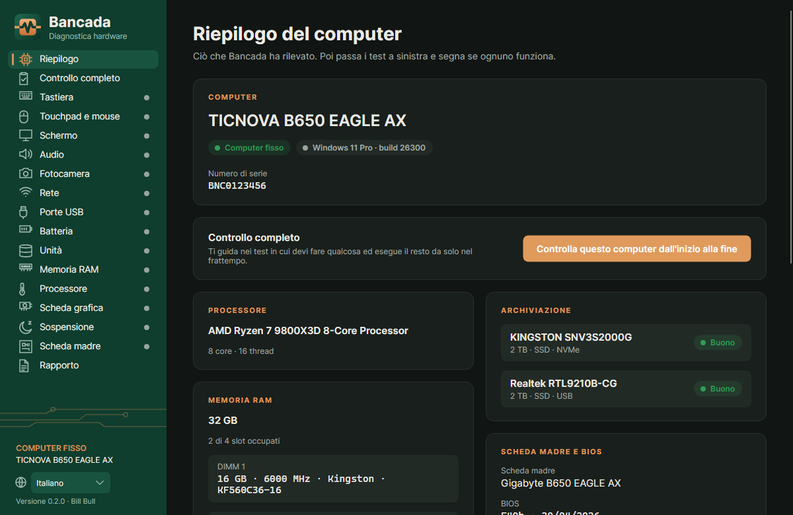
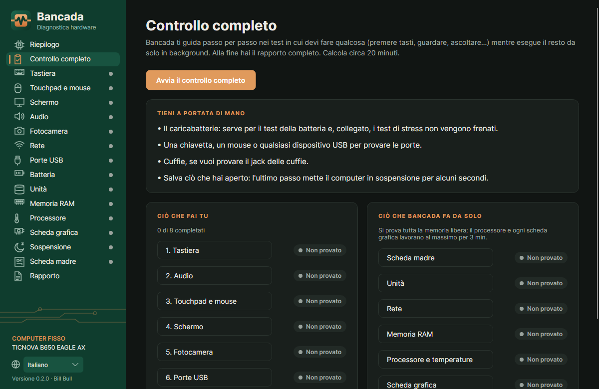
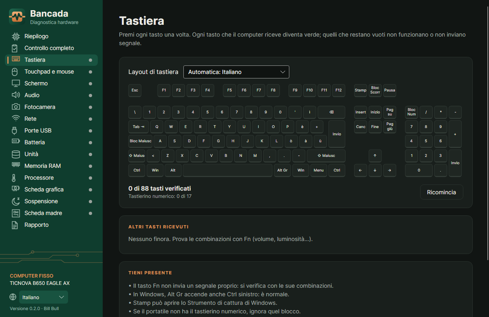
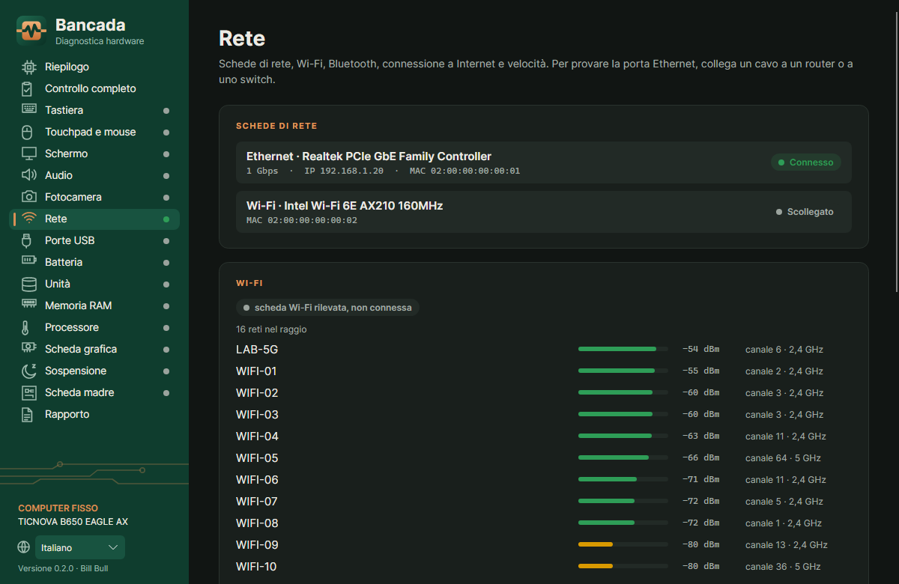
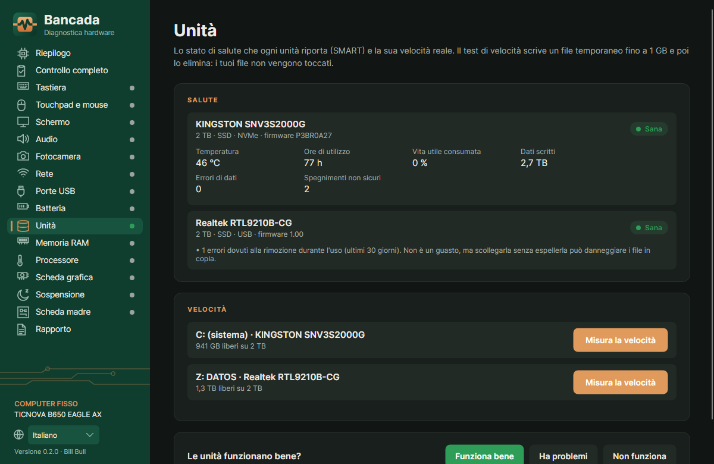
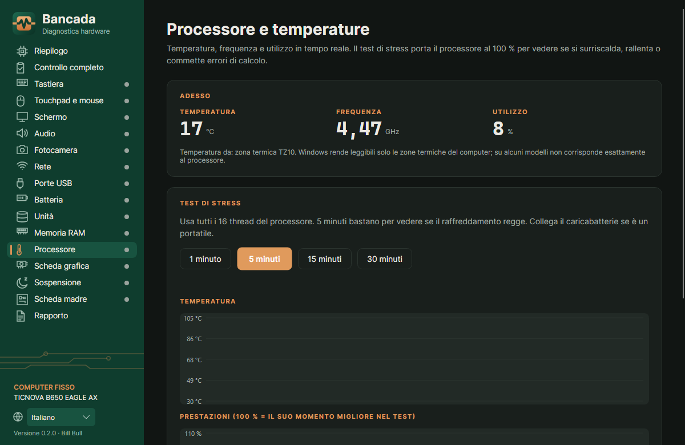
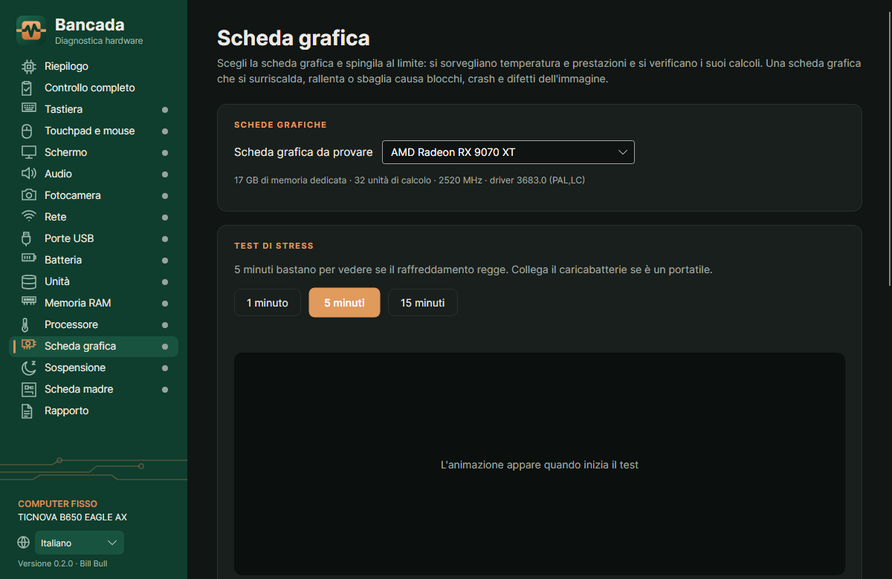
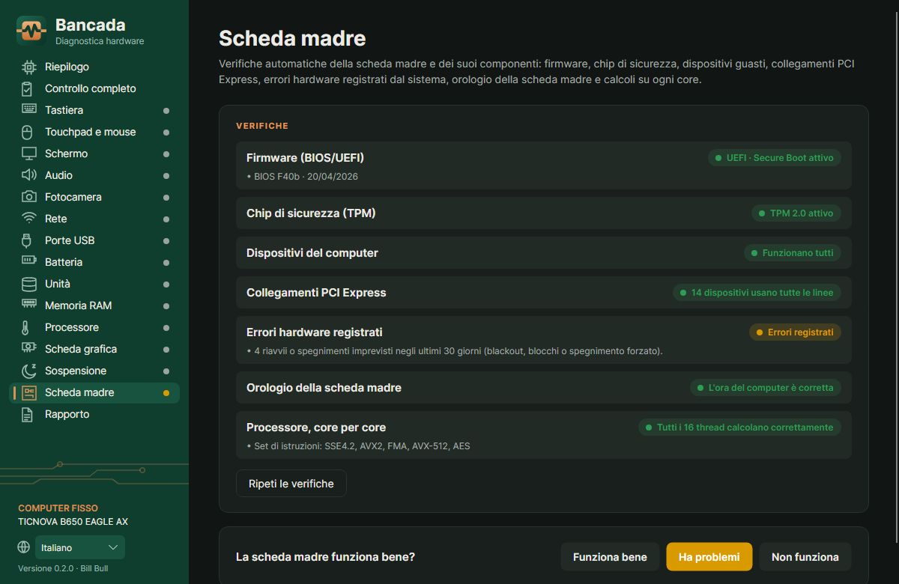
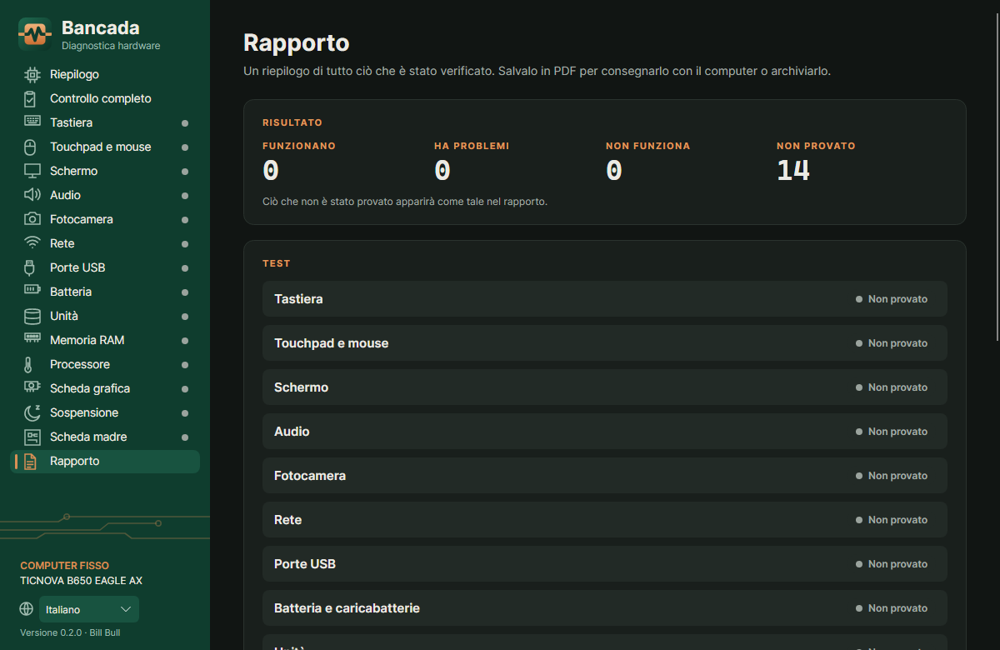

# Guida all'uso di Bancada

[English](en.md) · [Español](es.md) · [Português](pt.md) · [Français](fr.md) · [Deutsch](de.md) · **Italiano**

← [Torna al README](../../README.it.md)

## Prima di iniziare

1. **Scarica** l'eseguibile per il tuo sistema dall'[ultima versione](https://github.com/bancada-hw/bancada/releases/latest).
   Puoi portarlo su una chiavetta: non si installa e non lascia nulla sul computer tranne le sue impostazioni (lingua e tastiera).
2. **Aprilo** sul computer da controllare.
   - Windows: doppio clic. La prima volta può comparire *«PC protetto da Windows»*: fai clic su *Ulteriori informazioni › Esegui comunque*.
   - Linux: `chmod +x Bancada-linux-x64 && ./Bancada-linux-x64`.
3. **Tieni a portata di mano**: il caricabatterie (se è un portatile), una chiavetta o un mouse USB per le porte e, per provare il jack delle cuffie, delle cuffie.
4. **Permessi.** Quasi tutto funziona come utente normale. Come amministratore (Windows) o con `sudo` (Linux) vedi anche il numero di serie, i moduli di RAM e lo SMART completo delle unità SATA.

La lingua si sceglie in fondo alla barra laterale (icona del globo) e viene ricordata.

## La finestra principale

A sinistra c'è l'elenco dei test. Il punto colorato accanto a ciascuno indica il verdetto:
**Funziona bene**, **Ha problemi**, **Non funziona** o non provato.
Alla fine di ogni test c'è una barra per segnare il verdetto; nei test automatici è già proposto e puoi cambiarlo.

Il **Riepilogo** mostra cosa c'è nel computer: marca, modello e numero di serie, tipo (portatile, fisso,
all-in-one, mini PC), processore, RAM e slot occupati, schede grafiche, unità e la loro salute, batteria,
scheda madre e BIOS.

## Controllo completo (guidato)

Fai clic su **Avvia il controllo completo**. Bancada ti guida passo per passo nei test in cui devi fare qualcosa:
tastiera → audio → touchpad → schermo → fotocamera → USB → batteria → sospensione.
Nel frattempo, in background e uno dopo l'altro, esegue quelli automatici: scheda madre → unità → rete →
memoria → processore → ogni scheda grafica. Il pannello in basso mostra a che punto sono.

- I test di stress aspettano che tu finisca quello dell'audio, così il rumore delle ventole non disturba.
- Puoi saltare un passo; ciò che non viene provato appare come «Non provato» nel rapporto.
- L'ultimo passo sospende il computer per alcuni secondi: **salva ciò che hai aperto**.
- Calcola circa 20 minuti. Alla fine, fai clic su **Termina e vedi il rapporto**.

## I test uno per uno

### Tastiera

Premi ogni tasto una volta: quelli che arrivano diventano verdi; quelli che restano vuoti non funzionano o non
inviano segnale. Il layout segue la lingua e la tastiera del sistema; puoi sceglierne un altro dall'elenco
(spagnolo, latinoamericano, USA, Regno Unito, Portogallo, Brasile ABNT2, tedesco, francese e italiano).
I tasti multimediali (combinazioni con Fn) compaiono in «Altri tasti ricevuti».
In Windows, Alt Gr accende anche Ctrl sinistro e Stamp può aprire lo Strumento di cattura: è normale.

### Touchpad e mouse
Muovi il puntatore sull'area finché non è piena. Se in qualche punto si ferma o salta, quella parte del touchpad è
danneggiata: passa anche su bordi e angoli. Prova clic sinistro, destro e centrale, doppio clic, trascinamento,
la rotellina o lo scorrimento a due dita, i pulsanti laterali, lo schermo tattile e la penna se ci sono.

### Schermo
**Avvia il test dello schermo** riempie lo schermo di colori pieni, sfumature e griglia.
Clic, Spazio o → va avanti; ← torna indietro; Esc esce. Cerca pixel morti o bloccati, macchie, perdite di luce
ai bordi, bande nelle sfumature e luminosità non uniforme.

### Audio
Ogni pulsante suona da un solo lato; lo sweep dai bassi agli acuti serve a sentire se qualcosa vibra, ronza o
gracchia. **Ascolta il microfono** mostra il livello dal vivo (parla o batti le mani) e **Registra 5 secondi e
riascolta** ti fa sentire cosa ha captato. Poi collega le cuffie e ripeti per provare il jack.

### Fotocamera
Accendi ogni fotocamera e controlla che l'immagine sia nitida, con colori normali e senza interruzioni. Se è
nera, controlla lo sportellino della privacy o il tasto che la disattiva. L'immagine non viene mai salvata e non
esce mai dal computer.

### Rete

Elenca le schede fisiche con la velocità del collegamento, il Wi-Fi con le reti vicine (segnale, canale e banda)
e il Bluetooth. La connessione si verifica passo per passo (router → DNS → Internet → sito sicuro) per vedere dove
si interrompe. **Misura la velocità** fa 10 s di download e 10 s di upload con i server di Cloudflare.
Per provare la porta Ethernet, collega un cavo a un router o a uno switch.

### Porte USB
Collega una chiavetta, un mouse o qualsiasi dispositivo a ogni porta, una alla volta: ogni porta che risponde viene
segnata con la sua velocità reale. Se un dispositivo USB 3 si collega a velocità USB 2, prova un altro cavo; se non
cambia nulla, il connettore della porta potrebbe essere danneggiato. Mouse e tastiera vanno sempre a USB 1 o 2.

### Batteria e caricabatterie
Mostra la capacità nominale e attuale, la salute, i cicli e il consumo dal vivo.
- **Test del caricabatterie:** scollega e ricollega seguendo i passi; verifica caricabatterie, cavo e connettore.
- **Test di scarica:** con il caricabatterie scollegato, misura quanto dura davvero la batteria. Scegli cosa fa il
  computer (a riposo con lo schermo acceso, navigazione, video o carico massimo), quando fermarsi (a tempo o a una
  percentuale) e la luminosità. Rileva cali improvvisi della percentuale (celle in cattivo stato) e un indicatore
  starato. Fanne diversi con usi diversi: il rapporto li riunisce in una tabella di autonomia.

### Unità

Salute SMART di ogni unità (temperatura, ore, vita utile consumata, settori danneggiati), errori di lettura e
scrittura registrati dal sistema e velocità reale di lettura, scrittura e lettura casuale 4 KB. Il test di velocità
scrive un file temporaneo fino a 1 GB e poi lo elimina: i tuoi file non vengono toccati.

### Memoria RAM
Riempie la memoria libera con 8 schemi e verifica che si rilegga esattamente ciò che è stato scritto. Un solo errore
significa che un modulo è difettoso; prova i moduli uno alla volta per capire quale. Con il sistema in funzione si
può provare solo la memoria libera: per provarla tutta, Bancada apre Diagnostica memoria Windows o ti spiega come
avviare MemTest86+ su Linux.

### Processore

Temperatura, frequenza e utilizzo dal vivo. Il test di stress usa tutti i thread e sorveglia se si scalda troppo,
se rallenta per la temperatura o se sbaglia qualche calcolo. 5 minuti bastano per vedere se il raffreddamento regge;
se è un portatile, collega il caricabatterie.

### Scheda grafica

Scegli la scheda per nome (dedicata, integrata o qualsiasi altra) e spingila al massimo: temperatura e prestazioni
vengono sorvegliate e i suoi calcoli verificati. **Verifica la memoria video** cerca guasti della VRAM, quelli che
causano linee e punti colorati. Usa OpenCL, incluso nei driver NVIDIA, AMD e Intel; su Linux potrebbe servire
installare il pacchetto OpenCL della tua scheda.

### Sospensione
Sospende il computer e verifica che torni bene: quanto ha dormito, se la rete si ripristina e se qualche
dispositivo ha smesso di funzionare. Sui computer con sospensione moderna, riattivalo tu con un tasto come farebbe
il cliente. Se non torna e bisogna forzare lo spegnimento, alla riapertura Bancada lo segna come guasto.

### Scheda madre

Verifiche automatiche: firmware e avvio protetto, chip TPM, dispositivi guasti o senza driver, collegamenti PCI
Express con meno linee del dovuto, errori hardware registrati, orologio della scheda madre (batteria CMOS) e calcolo
corretto su ogni core.

## Il rapporto

Riunisce tutti i test con misure, note e verdetti. Aggiungi le tue note (stato fisico, ammaccature, cosa ha detto il
cliente…) e fai clic su **Salva il rapporto in PDF**: viene salvato in Documenti e include il numero di serie del computer.

## Problemi frequenti

| Cosa succede | Cosa fare |
|---|---|
| Windows avvisa che il programma non è sicuro | L'eseguibile non è ancora firmato: *Ulteriori informazioni › Esegui comunque*. |
| Nessuna temperatura del processore in Windows | Alcuni computer la comunicano solo a programmi con un proprio driver. Il test di stress rileva comunque perdite di prestazioni ed errori. |
| «Non c'è nessun driver OpenCL installato» nella scheda grafica | Installa o aggiorna il driver dal sito di NVIDIA, AMD o Intel. Su Linux: `intel-opencl-icd`, `mesa-opencl-icd` o ROCm. |
| Nessuna rete Wi-Fi in Windows | Attiva *Impostazioni › Privacy e sicurezza › Posizione › Consenti alle app desktop di accedere alla posizione*. |
| Nessun dato SMART su Linux | Installa `smartmontools` e avvia Bancada con `sudo`. |
| Su Linux non si avvia e chiede libICE o libSM | Installa `libice6` e `libsm6` (servono all'interfaccia X11). |
