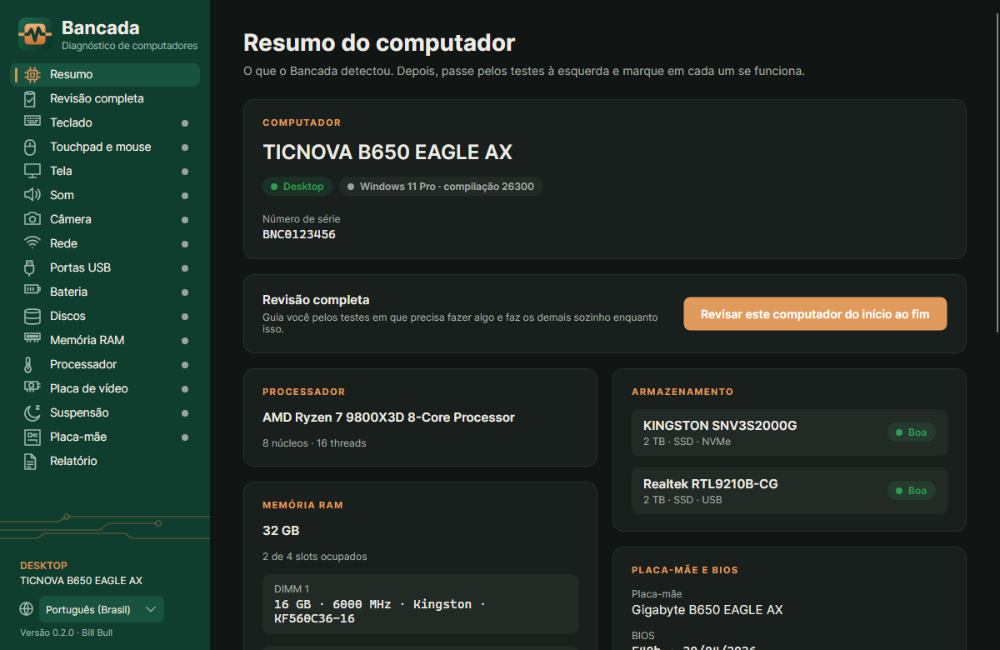
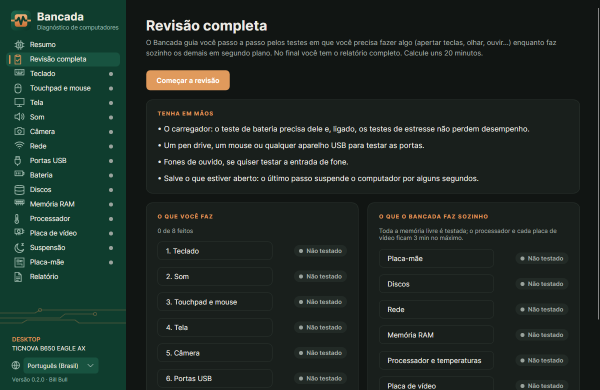
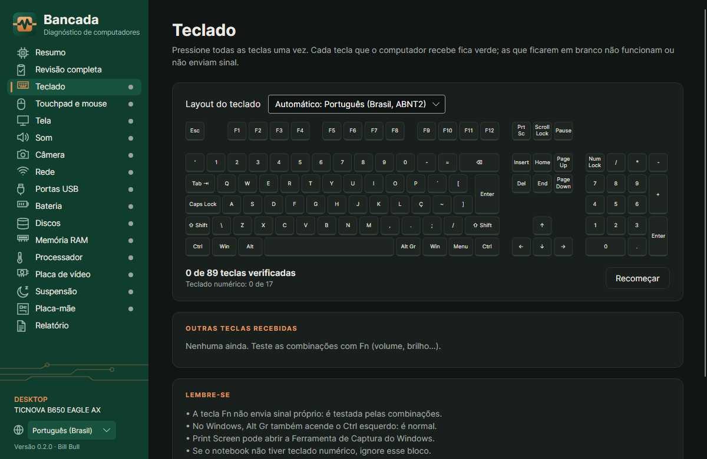
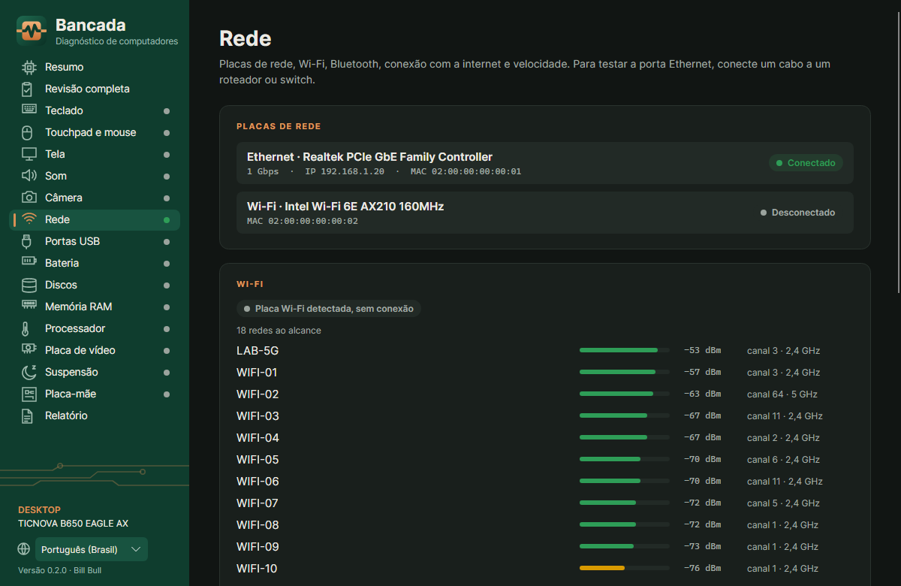
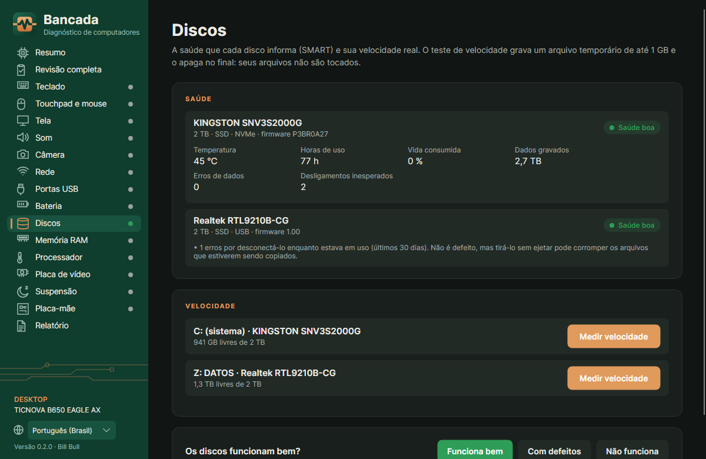
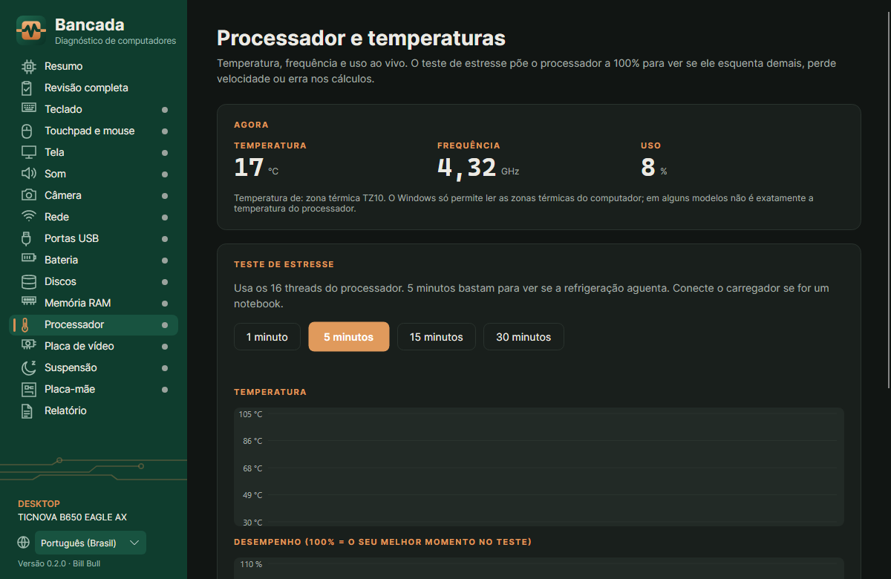
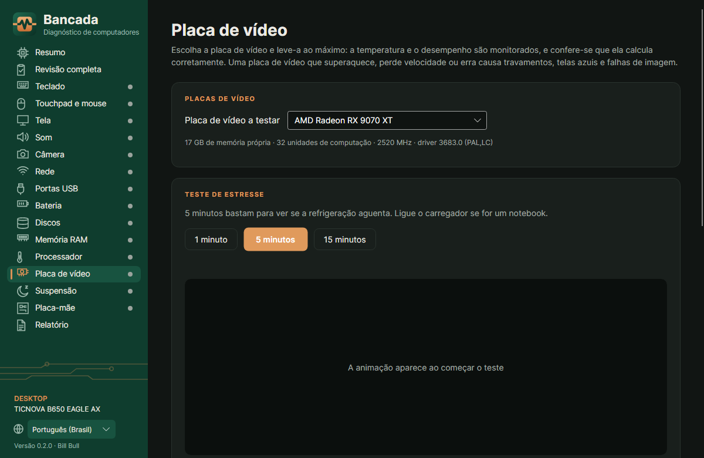
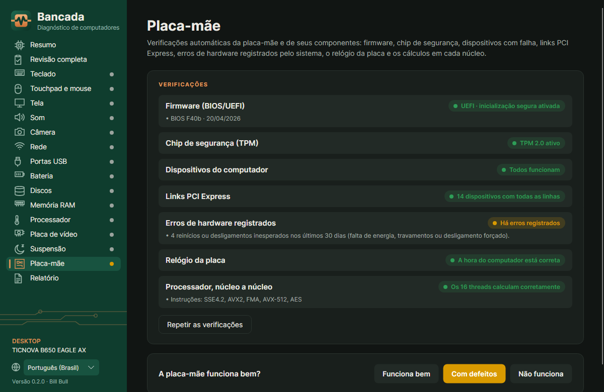
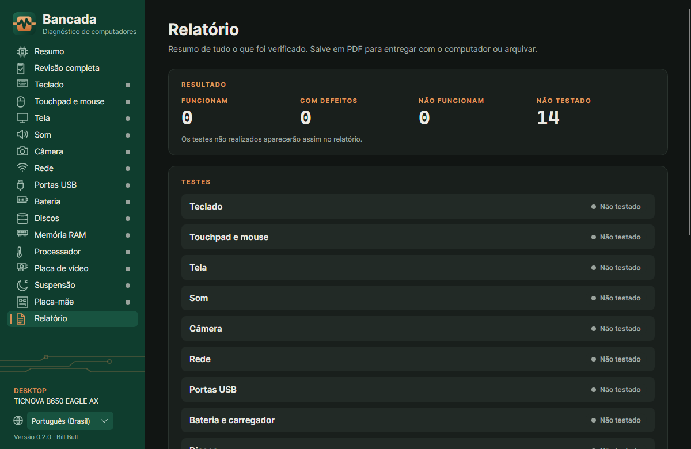

# Guia de uso da Bancada

[English](en.md) · [Español](es.md) · **Português** · [Français](fr.md) · [Deutsch](de.md) · [Italiano](it.md)

← [Voltar ao README](../../README.pt.md)

## Antes de começar

1. **Baixe** o executável do seu sistema na [última versão](https://github.com/bancada-hw/bancada/releases/latest).
   Você pode levá-lo num pendrive: não é instalado e não deixa nada no computador além das suas configurações (idioma e teclado).
2. **Abra-o** no computador que vai revisar.
   - Windows: clique duas vezes. Na primeira vez pode aparecer *«O Windows protegeu o computador»*: clique em *Mais informações › Executar assim mesmo*.
   - Linux: `chmod +x Bancada-linux-x64 && ./Bancada-linux-x64`.
3. **Tenha à mão**: o carregador (se for notebook), um pendrive ou mouse USB para as portas e, para testar a entrada de fone, um fone de ouvido.
4. **Permissões.** Quase tudo funciona como usuário comum. Como administrador (Windows) ou com `sudo` (Linux) você vê também o número de série, os módulos de RAM e o SMART completo dos discos SATA.

O idioma é escolhido na parte de baixo da barra lateral (ícone do globo) e fica salvo.

## A tela principal

À esquerda fica a lista de testes. O ponto colorido ao lado de cada um indica o veredito:
**Funciona bem**, **Com defeitos**, **Não funciona** ou não testado.
No final de cada teste há uma barra para marcar o veredito; nos automáticos ele vem sugerido e você pode mudá-lo.

O **Resumo** mostra o que o computador tem: marca, modelo e número de série, tipo (notebook, desktop,
all-in-one, mini PC), processador, RAM e slots ocupados, placas de vídeo, discos e sua saúde, bateria,
placa-mãe e BIOS.

## Revisão completa (guiada)

Clique em **Começar a revisão**. A Bancada guia você passo a passo pelos testes em que é preciso fazer algo:
teclado → som → touchpad → tela → câmera → USB → bateria → suspensão.
Enquanto isso, em segundo plano e um após o outro, faz os automáticos: placa-mãe → discos → rede →
memória → processador → cada placa de vídeo. O painel de baixo mostra o andamento.

- Os testes de estresse esperam você terminar o de som, para que o barulho da ventoinha não atrapalhe.
- Você pode pular um passo; o que não for testado aparece como «Não testado» no relatório.
- O último passo suspende o computador por alguns segundos: **salve o que estiver aberto**.
- Conte com uns 20 minutos. Ao terminar, clique em **Terminar e ver o relatório**.

## Testes um a um

### Teclado

Pressione cada tecla uma vez: as que chegam ficam verdes; as que ficam sem cor não funcionam ou não enviam
sinal. O layout segue o idioma e o teclado do sistema; você pode escolher outro na lista (espanhol,
latino-americano, EUA, Reino Unido, Portugal, Brasil ABNT2, alemão, francês e italiano).
As teclas multimídia (combinações com Fn) aparecem em «Outras teclas recebidas».
No Windows, Alt Gr acende também o Ctrl esquerdo, e Print Screen pode abrir a Ferramenta de Captura: é normal.

### Touchpad e mouse
Mova o ponteiro pela área até preenchê-la. Se em algum lugar ele parar ou pular, essa parte do touchpad está
danificada: passe também pelas bordas e cantos. Teste clique esquerdo, direito e do meio, duplo clique,
arrastar, a roda ou a rolagem com dois dedos, os botões laterais, a tela sensível ao toque e a caneta, se houver.

### Tela
**Começar teste de tela** enche a tela de cores sólidas, degradês e grade.
Clique, Espaço ou → avança; ← volta; Esc sai. Procure pixels mortos ou travados, manchas, vazamentos de luz
nas bordas, faixas nos degradês e brilho irregular.

### Som
Cada botão toca de um lado só; a varredura de graves a agudos serve para ouvir se algo vibra, zumbe ou chia.
**Ouvir o microfone** mostra o nível ao vivo (fale ou bata palmas) e **Gravar 5 segundos e reproduzir** deixa
você ouvir o que ele captou. Depois conecte um fone e repita para testar a entrada.

### Câmera
Ligue cada câmera e veja se a imagem está nítida, com cores normais e sem cortes. Se sair preta, verifique a
tampa de privacidade ou a tecla que a desativa. A imagem nunca é salva nem sai do computador.

### Rede

Lista as placas físicas com a velocidade do link, o Wi-Fi com as redes próximas (sinal, canal e banda) e o
Bluetooth. A conexão é verificada passo a passo (roteador → DNS → internet → site seguro) para ver onde ela
cai. **Medir velocidade** faz 10 s de download e 10 s de upload com os servidores da Cloudflare.
Para testar a porta Ethernet, conecte um cabo a um roteador ou switch.

### Portas USB
Conecte um pendrive, um mouse ou qualquer aparelho em cada porta, uma de cada vez: cada porta que responde é
marcada com sua velocidade real. Se um aparelho USB 3 conectar em velocidade USB 2, teste outro cabo; se nada
mudar, o conector da porta pode estar danificado. Mouse e teclado sempre funcionam em USB 1 ou 2.

### Bateria e carregador
Mostra a capacidade de fábrica e a atual, a saúde, os ciclos e o consumo ao vivo.
- **Teste do carregador:** desconecte e reconecte seguindo os passos; verifica carregador, cabo e conector.
- **Teste de descarga:** com o carregador desconectado, mede quanto a bateria dura de verdade. Você escolhe o
  que o computador faz (em repouso com a tela ligada, navegando, vendo vídeo ou em carga máxima), quando parar
  (por tempo ou ao chegar a uma porcentagem) e o brilho. Detecta quedas bruscas da porcentagem (células ruins) e
  um indicador descalibrado. Faça vários com usos diferentes e o relatório os reúne numa tabela de autonomia.

### Discos

Saúde SMART de cada disco (temperatura, horas, vida útil consumida, setores danificados), erros de leitura e
gravação registrados pelo sistema e velocidade real de leitura, gravação e leitura aleatória de 4 KB.
O teste de velocidade grava um arquivo temporário de até 1 GB e o apaga no final: seus arquivos não são tocados.

### Memória RAM
Enche a memória livre com 8 padrões e verifica se lê exatamente o que foi gravado. Um único erro significa
que um módulo está com defeito; teste os módulos um por um para descobrir qual. Com o sistema rodando só dá para
testar a memória livre: para testá-la inteira, a Bancada abre o Diagnóstico de Memória do Windows ou indica
como iniciar o MemTest86+ no Linux.

### Processador

Temperatura, frequência e uso ao vivo. O teste de estresse usa todos os threads e vigia se esquenta demais,
se perde desempenho pela temperatura e se algum cálculo sai errado. 5 minutos bastam para ver se a refrigeração
aguenta; se for notebook, conecte o carregador.

### Placa de vídeo

Escolha a placa pelo nome (dedicada, integrada ou qualquer outra) e leve-a ao máximo: temperatura e desempenho
são monitorados e seus cálculos são verificados. **Verificar a memória de vídeo** procura falhas de VRAM, as que
causam riscos e pontos coloridos. Usa OpenCL, que vem com os drivers da NVIDIA, AMD e Intel; no Linux pode ser
preciso instalar o pacote OpenCL da sua placa.

### Suspensão
Suspende o computador e verifica se ele volta bem: quanto tempo dormiu, se a rede se recupera e se algum
dispositivo parou de funcionar. Em computadores com suspensão moderna, acorde-o você com uma tecla, como faria
o cliente. Se ele não voltar e for preciso forçar o desligamento, ao abrir a Bancada de novo isso é marcado como falha.

### Placa-mãe

Verificações automáticas: firmware e inicialização segura, chip TPM, dispositivos com falha ou sem driver,
links PCI Express com menos lanes do que deveriam, erros de hardware registrados, relógio da placa (bateria CMOS)
e cálculo correto em cada núcleo.

## O relatório

Reúne todos os testes com suas medições, observações e vereditos. Adicione suas notas (estado físico, amassados,
o que o cliente contou…) e clique em **Salvar relatório em PDF**: ele é salvo em Documentos e inclui o número de
série do computador.

## Problemas frequentes

| O que acontece | O que fazer |
|---|---|
| O Windows avisa que o programa não é seguro | O executável ainda não é assinado: *Mais informações › Executar assim mesmo*. |
| Não aparece a temperatura do processador no Windows | Alguns computadores só a informam a programas com driver próprio. O teste de estresse continua detectando perda de desempenho e erros. |
| «Não há nenhum driver OpenCL instalado» na placa de vídeo | Instale ou atualize o driver no site da NVIDIA, AMD ou Intel. No Linux: `intel-opencl-icd`, `mesa-opencl-icd` ou ROCm. |
| Não aparecem as redes Wi-Fi no Windows | Ative *Configurações › Privacidade e segurança › Localização › Permitir que aplicativos da área de trabalho acessem sua localização*. |
| No Linux não aparecem os dados SMART | Instale `smartmontools` e abra a Bancada com `sudo`. |
| No Linux não abre e pede libICE ou libSM | Instale `libice6` e `libsm6` (a interface em X11 precisa delas). |
